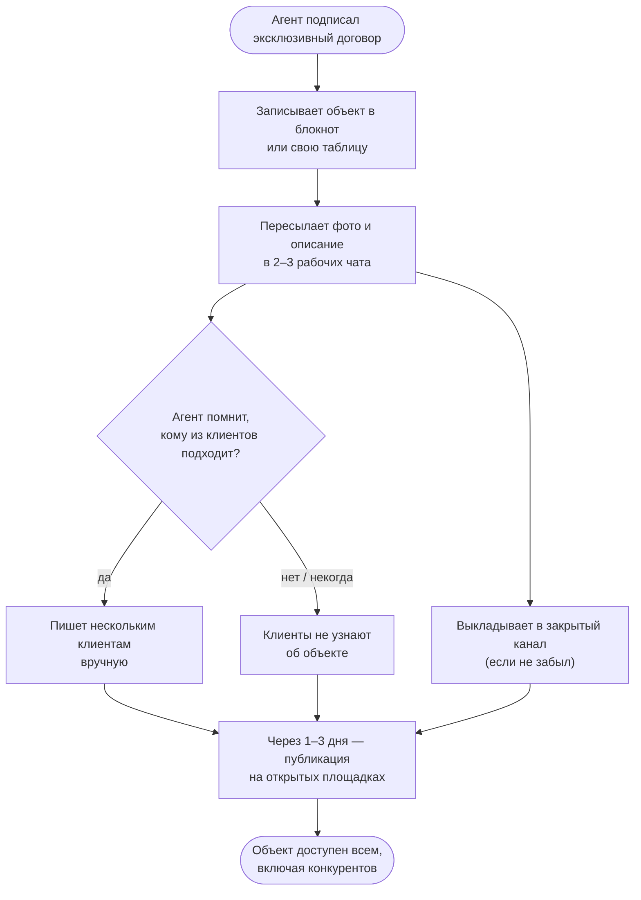
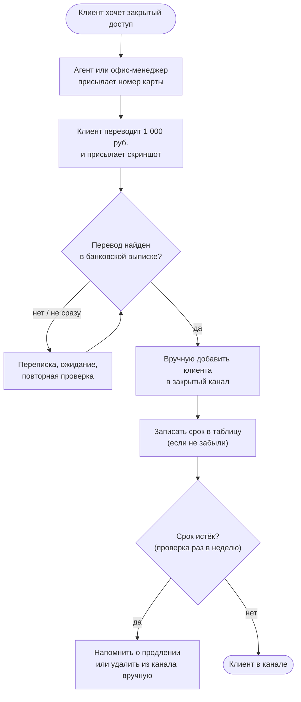
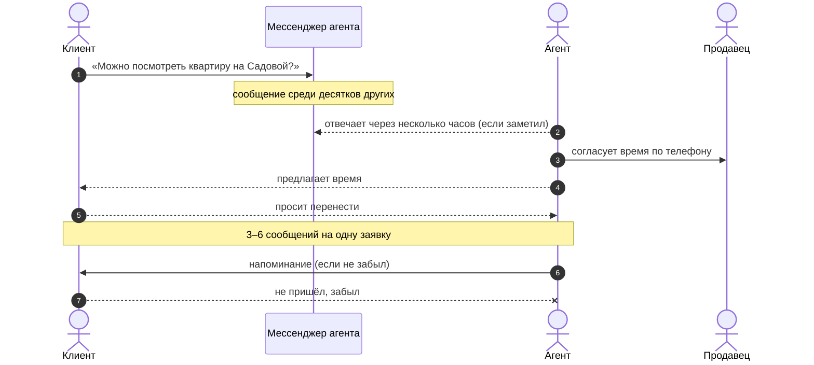

# Глава 1. Анализ операционной деятельности «как есть»

## 1.1. Общая характеристика предприятия

**ООО «Квартирант плюс»** — агентство недвижимости в крупном региональном
городе. Основной вид деятельности — посредничество при покупке и продаже
квартир на вторичном рынке и в новостройках; доход — комиссия с продавца или
покупателя. Сильная сторона агентства — **эксклюзивные договоры**: продавец
поручает продажу только «Квартиранту плюс», и агентство вправе первым
показывать объект своим клиентам.

Около года назад агентство попробовало продавать «закрытый доступ»: за
1 000 руб. в месяц клиент попадал в закрытый канал в мессенджере, куда
агенты выкладывали эксклюзивы раньше, чем на открытые площадки объявлений.
Спрос подтвердился (около 40 платящих клиентов без всякой рекламы), но
процесс держался на ручной работе и быстро упёрся в её пределы.

Организационная структура: руководитель (он же собственник), восемь
агентов на агентском договоре с долей от комиссии, офис-менеджер. Штатного
ИТ-специалиста нет; сайт агентства — визитка, которую обновляют вручную.

Для расчётов используется модельный профиль нагрузки:

| Параметр | Значение | Основание |
|---|---|---|
| Агентов | 8 | структура агентства |
| Новых эксклюзивных объектов в месяц | 40 | модель: ≈ 5 на агента |
| Активная база клиентов, ищущих жильё | 1 000 | модель: контакты за последние 6 мес. |
| Платящих за «закрытый доступ» | 40 | модель, 1 000 руб./мес |
| Заявок на показ в месяц | 240 | модель |
| Проведено показов в месяц | 160 | модель: часть заявок теряется, часть клиентов не приходит |
| Сделок в месяц | 10 | модель |
| Средняя комиссия со сделки | 120 000 руб. | модель: ≈ 2 % от средней цены 6 млн руб. |
| Доля агента в комиссии | 50 % | модель агентского договора |
| Обращений клиентов с типовыми вопросами в месяц | 160 | модель |
| Обновлений сайта и списков в месяц | 4 | модель |
| Сбоев (недоступен канал, сайт, таблица) в месяц | 2 | модель |

## 1.2. Описание процессов «как есть»

### Процесс «Эксклюзивный объект → клиенты»

Особенности: общей базы объектов нет — «где лежит эксклюзив» знает только
агент, который его привёл. Коллеги узнают об объекте из чата, где он
быстро тонет среди сообщений. Подбор «объект ↔ клиент» держится на памяти
агента; клиент, оплативший ранний доступ, получает его не системно, а «как
повезёт». Достоверность сведений (цена, площадь, документы) никто, кроме
самого агента, не проверяет.

### Процесс «Оплата закрытого доступа»

Особенности: связь «платёж ↔ клиент» устанавливается по скриншоту и
памяти; от оплаты до доступа проходят часы (вечером и в выходные — до
следующего рабочего дня); просроченные клиенты неделями остаются в канале,
а продливший вовремя может быть по ошибке удалён. Приём денег на личную
карту сотрудника, кроме неудобства, создаёт налоговые и репутационные
риски и не даёт клиенту кассового чека [29].

### Процесс «Заявка на показ»

Около 15 % заявок теряются в переписке (на них просто не ответили вовремя),
а пятая часть назначенных показов срывается из-за неявки. Отсюда разница
между 240 заявками и 160 проведёнными показами в модельном профиле.

### Процесс «Управленческий учёт»

Руководитель раз в неделю собирает с агентов сведения: какие объекты в
работе, сколько было показов, какие сделки на подходе. Данные приходят
устно и в разном виде, сравнить агентов между собой нельзя, а вопрос
«какие объекты и районы продаются лучше» остаётся без ответа. Сколько
приносит закрытый канал, видно только по банковской выписке.

### Процесс «Эксплуатация»

Мониторинга нет. О том, что сайт не открывается или закрытый канал
перестал принимать новых участников, узнают от клиентов. Таблица с
эксклюзивами и сроками доступа хранится в облачном документе одного
сотрудника; резервные копии делаются нерегулярно и ни разу не
проверялись. Изменения на сайте выкладываются вручную, процедуры отката
нет.

## 1.3. Оценка трудозатрат

Время на одну операцию получено хронометражем типичных случаев и
округлено; объёмы — по модельному профилю п. 1.1. Ставка часа здесь не
нужна: таблица показывает, *куда* уходит рабочее время.

| № | Операция | Кто | Время на 1 операцию | Объём в месяц | Ч/мес |
|---|---|---|---|---|---|
| 1 | Учёт эксклюзива: запись, пересылка в чаты, ответы коллегам «что есть» | агент | 30 мин | 40 объектов | 20,0 |
| 2 | Ручное информирование клиентов о новых объектах | агент | 3 мин | 400 сообщений | 20,0 |
| 3 | Приём оплаты закрытого доступа: сверка перевода, добавление в канал, запись срока | офис-менеджер | 15 мин | 40 оплат | 10,0 |
| 4 | Контроль сроков доступа: проверка таблицы, напоминание, удаление из канала | офис-менеджер | 6 мин | 40 клиентов | 4,0 |
| 5 | Заявки на показ: разбор мессенджера, согласование, перенос, напоминание | агент | 8 мин | 240 заявок | 32,0 |
| 6 | Ответы на типовые вопросы («когда кончается доступ», «почему не пришло») | офис-менеджер | 6 мин | 160 обращений | 16,0 |
| 7 | Сбор еженедельного отчёта для руководителя | руководитель, агенты | 3 ч | 4 отчёта | 12,0 |
| 8 | Ручное обновление сайта и списков объектов | офис-менеджер | 1,5 ч | 4 обновления | 6,0 |
| 9 | Поиск и устранение сбоев | офис-менеджер, руководитель | 4 ч | 2 сбоя | 8,0 |
| 10 | Резервное копирование таблиц | офис-менеджер | 30 мин | 4 раза | 2,0 |
| | **Итого** | | | | **130,0** |

Расчёт строки 1: 40 × 30 мин = 1 200 мин = 20 ч; строки 5: 240 × 8 мин =
1 920 мин = 32 ч. Остальные строки считаются так же.

130 часов в месяц — это примерно 0,8 полной ставки (130 / 165 ≈ 0,79),
которые уходят **только на рутину**. Важнее другое: 72 часа из них (строки
1, 2 и 5) — время агентов, то есть самых дорогих сотрудников, чья работа —
показы и сделки, а не пересылка сообщений.

## 1.4. Узкие места и «боли»

| Узкое место | Проявление | Последствие для клиента | Последствие для бизнеса |
|---|---|---|---|
| Нет общей базы объектов | Эксклюзив знает только «свой» агент | Подходящий объект не показывают | Объект уходит на открытые площадки, преимущество агентства теряется |
| Подбор по памяти агента | Подписчик узнаёт об объекте через 1–3 дня или не узнаёт вовсе | Платит за ранний доступ, а получает поздний | Отказ от продления, слабое ценностное предложение подписки |
| Ручная оплата закрытого доступа | От оплаты до доступа — часы, иногда сутки | Недоверие, повторные сообщения «я оплатил» | Нагрузка на офис-менеджера, ошибки, нет чеков |
| Ручной контроль сроков | Просроченные остаются, вовремя продлившие удаляются | Конфликты | Потери выручки и репутации |
| Заявки на показ в мессенджере | ≈ 15 % заявок теряется, ≈ 20 % неявок | «Мне не ответили» | Меньше показов — меньше сделок |
| Нет управленческого учёта | Отчёт раз в неделю устно | — | Руководитель не видит вклад агентов и спрос по районам |
| Нет мониторинга и проверенных копий | О сбоях узнают от клиентов, копии не проверялись | Канал «не работает» | Риск потери базы клиентов и эксклюзивов |
| Нет журнала действий | Неизвестно, кто изменил цену или удалил клиента | Споры | Нет основы для разбора ошибок |

## 1.5. Оценка цифровой зрелости «как есть»

| Область | Уровень (1–5) | Обоснование |
|---|---|---|
| Работа с объектами | 1 | Блокноты и чаты, общей базы нет |
| Продажа и обслуживание подписки | 1 | Перевод на карту, ручная выдача и снятие доступа |
| Показы | 1 | Мессенджер, нет учёта заявок |
| Управленческий учёт | 1 | Устные еженедельные отчёты |
| Разработка и выкладка | 1 | Ручные правки сайта без отката |
| Мониторинг и инциденты | 1 | Мониторинга нет |
| Данные и резервирование | 1–2 | Копии есть, но нерегулярно и без проверки |

**Вывод по главе.** Агентство находится на начальном уровне цифровой
зрелости по всем областям. Главный ограничитель — не спрос (подписка
продаётся и без рекламы) и не технологии, а то, что ценный актив —
эксклюзивные объекты — не собран в одном месте, а каждая операция с
клиентом проходит через память конкретного сотрудника. Наибольший эффект
даст сквозная автоматизация цепочки «объект → каталог → подписчик → показ»
(строки 1, 2 и 5 — 72 ч/мес, 55 % трудозатрат) вместе с автоматической
продажей подписки, а условием надёжности — эксплуатационный контур:
мониторинг, безопасная выкладка и проверенное резервирование.
