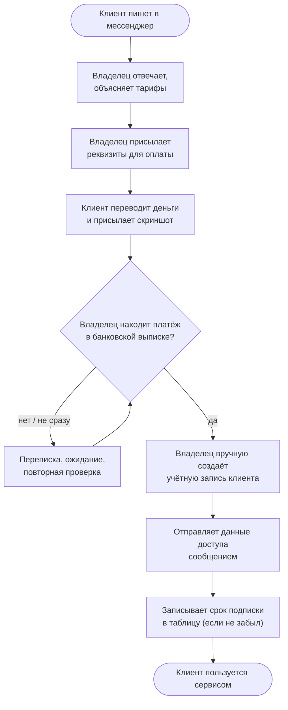

# Глава 1. Анализ операционной деятельности «как есть»

## 1.1. Общая характеристика предприятия

**ООО «Сервис»** — небольшой онлайн-сервис цифровых подписок, модель B2C.
Продукт — доступ к облачному сервису на 1, 3 или 12 месяцев. Клиенты —
частные лица; канал продаж — мессенджер; основная коммуникация с клиентом —
там же.

Организационная структура предельно плоская: владелец совмещает роли
руководителя, продавца, бухгалтера, сотрудника поддержки и системного
администратора. Привлечённых сотрудников нет. Вся операционная деятельность
зависит от доступности одного человека.

Для расчётов в работе используется модельный профиль нагрузки:

| Параметр | Значение | Основание |
|---|---|---|
| Заказов в месяц | 600 | экспертная оценка, модель |
| Обращений в поддержку в месяц | 300 | модель: ≈ 1 обращение на 2 заказа |
| Выкладок новых версий в месяц | 4 | модель для исходного состояния |
| Инцидентов (сбоев) в месяц | 3 | модель для исходного состояния |
| Средний чек | ≈ 650 руб. | модель: смесь тарифов 1/3/12 мес. |

## 1.2. Описание процессов «как есть»

### Процесс «Продажа и выдача доступа»

Особенности: каждый шаг выполняется человеком; связь «платёж ↔ заказ»
устанавливается по скриншоту и памяти; срок подписки хранится в таблице,
которую нужно не забыть обновить; продление — это повтор всего процесса.

### Процесс «Поддержка клиентов»

Обращения приходят в тот же чат, что и заказы, и смешиваются с ними. Нет
очереди, приоритетов и истории по клиенту: чтобы ответить, владелец
пролистывает переписку. Типовые вопросы («как подключиться», «когда
заканчивается подписка», «у меня не работает») составляют основную часть
обращений, но на каждый отвечают вручную.

### Процесс «Выкладка новой версии»

Владелец вносит изменения в код, копирует файлы на сервер, перезапускает
службу и проверяет работу «на себе». Автоматических тестов нет, процедура
отката не описана: при ошибке приходится в спешке вспоминать предыдущее
состояние. Поэтому изменения выкладываются редко и пачками, что увеличивает
риск каждой выкладки — классический порочный круг, описанный в литературе по
непрерывной поставке [8].

### Процесс «Эксплуатация и инциденты»

Мониторинга нет. О сбое владелец узнаёт от клиентов — то есть с задержкой и
в момент, когда репутационный ущерб уже нанесён. Причину ищут вручную по
журналам сервера. Резервные копии делаются нерегулярно, их восстановление
ни разу не проверялось — фактически неизвестно, существует ли рабочая копия.

## 1.3. Оценка трудозатрат

Оценка времени на одну операцию получена хронометражем типичных случаев и
округлена; объёмы — по модельному профилю из п. 1.1.

| № | Операция | Кто | Время на 1 операцию | Объём в месяц | Ч/мес | Доля ручного труда |
|---|---|---|---|---|---|---|
| 1 | Приём заявки, консультация до оплаты | владелец | 3 мин | 600 заказов | 30,0 | 100 % |
| 2 | Проверка оплаты, сверка с выпиской | владелец | 2 мин | 600 заказов | 20,0 | 100 % |
| 3 | Выдача доступа, запись срока | владелец | 2 мин | 600 заказов | 20,0 | 100 % |
| 4 | Ответы на обращения поддержки | владелец | 8 мин | 300 обращений | 40,0 | 100 % |
| 5 | Выкладка новой версии | владелец | 90 мин | 4 выкладки | 6,0 | 100 % |
| 6 | Поиск и устранение сбоев | владелец | 4 ч | 3 инцидента | 12,0 | 100 % |
| 7 | Резервное копирование | владелец | 30 мин | 4 раза | 2,0 | 100 % |
| | **Итого** | | | | **130,0** | **100 %** |

Расчёт строки 1: 600 × 3 мин = 1 800 мин = 30 ч. Остальные строки
считаются так же.

130 часов в месяц — это примерно 0,8 ставки при 40-часовой неделе
(130 / 165 ≈ 0,79), которые уходят **только на рутину**, без развития продукта.

## 1.4. Узкие места и «боли»

| Узкое место | Проявление | Последствие для клиента | Последствие для бизнеса |
|---|---|---|---|
| Ручная выдача доступа | От оплаты до доступа — от 15 минут до нескольких часов (ночью — до утра) | Ожидание, недоверие, повторные сообщения «я оплатил» | Отказы, возвраты, нагрузка на поддержку |
| Ручная сверка платежей | Платёж по скриншоту, без связи с заказом | Споры «я платил» | Ошибки начисления, двойные выдачи, потери |
| Единая точка отказа — человек | Болезнь или отпуск владельца останавливают продажи | Сервис «не отвечает» | Прямая потеря выручки |
| Нет мониторинга | Время обнаружения сбоя (MTTD) — часы | Сервис не работает, никто не знает | Отток, репутационный ущерб |
| Рискованные редкие выкладки | Нет тестов и отката | Новые ошибки после обновлений | Страх изменений, медленное развитие |
| Нерегулярные копии без проверки | Неизвестно, можно ли восстановиться | — | Риск потери всей базы клиентов |
| Нет журналов действий | Невозможно восстановить, кто и что изменил | — | Нет основы для разбора ошибок и споров |

## 1.5. Оценка цифровой зрелости «как есть»

| Область | Уровень (1–5) | Обоснование |
|---|---|---|
| Продажи и оплата | 1 | Всё вручную, связь платежа и заказа не формализована |
| Выдача доступа | 1 | Вручную, срок — в таблице |
| Поддержка | 1 | Общий чат, нет истории и очереди |
| Разработка и выкладка | 1 | Нет тестов, нет процедуры отката |
| Мониторинг и инциденты | 1 | Нет мониторинга |
| Данные и резервирование | 1–2 | Копии есть, но нерегулярно и без проверки |

**Вывод по главе.** Предприятие находится на начальном уровне цифровой
зрелости по всем областям. Основной ограничитель роста — не спрос и не
технология, а то, что каждая операция проходит через одного человека.
Наибольший эффект даст автоматизация сквозного процесса «заказ → оплата →
выдача доступа» (строки 1–3, 70 ч/мес, 54 % трудозатрат) и создание
эксплуатационного контура: мониторинга, безопасной выкладки и проверенного
резервирования.
