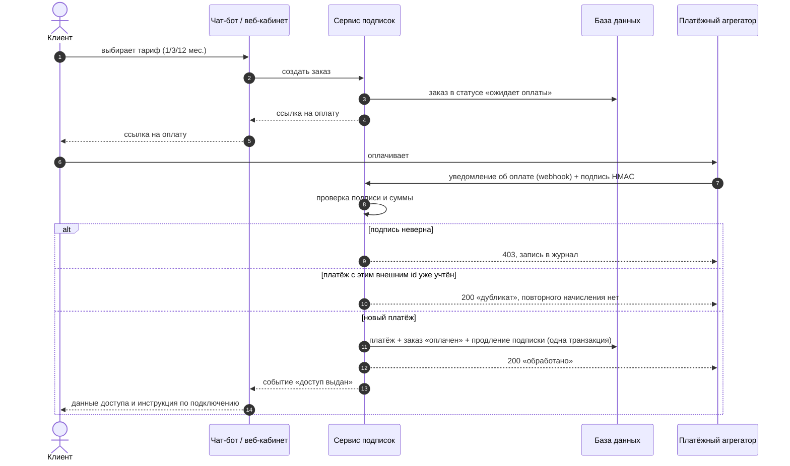
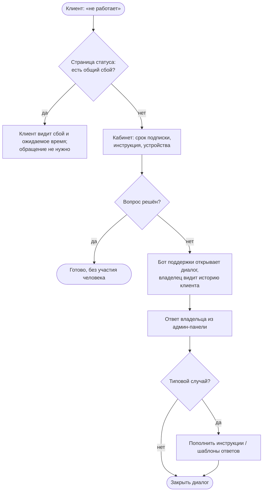
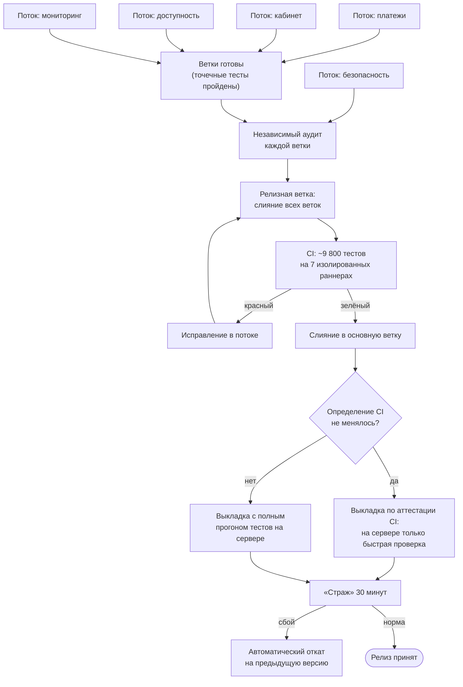
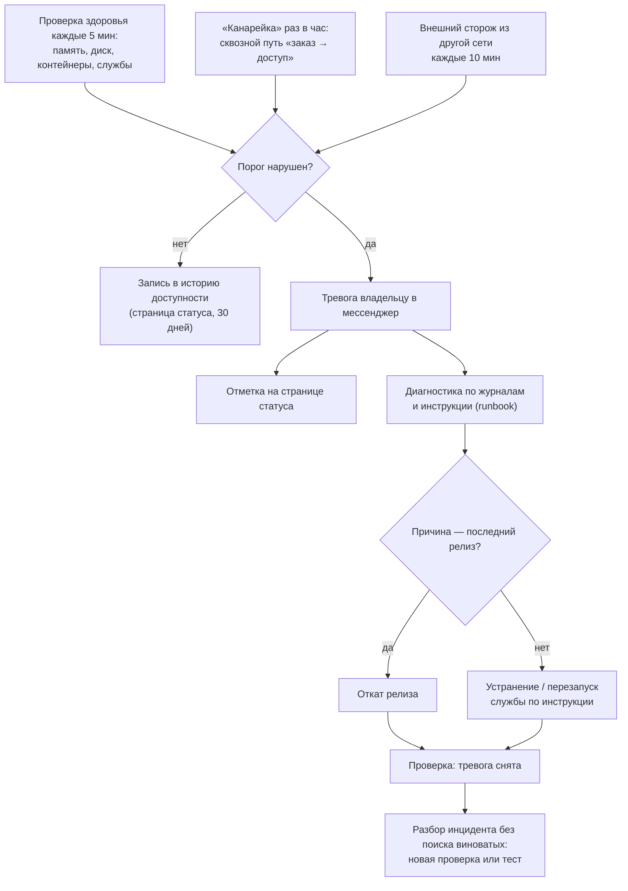
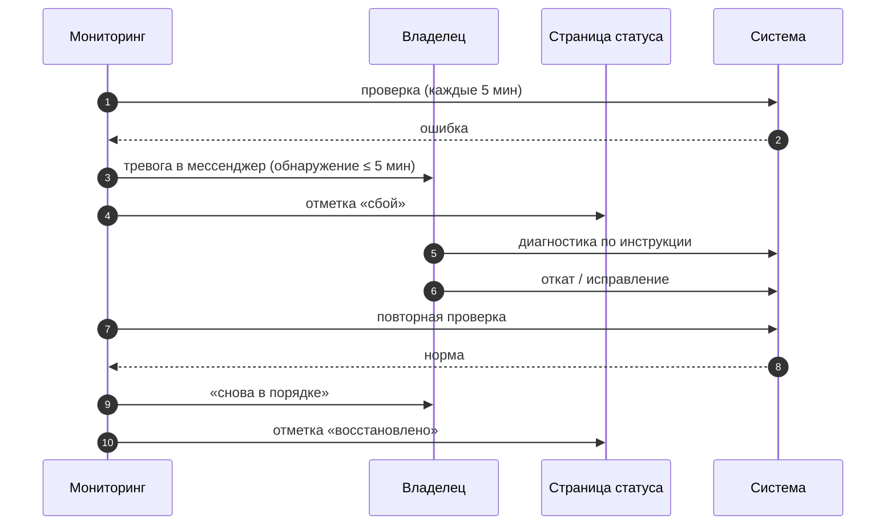

# Глава 2. Целевая модель процессов «как будет»

## 2.1. Принципы проектирования

Целевая модель строилась по пяти принципам. Каждый из них — ответ на
конкретную «боль» из главы 1.

1. **Человек — на исключениях, а не на потоке.** Типовой случай проходит без
   участия владельца; он подключается, когда автоматика сообщает о
   нестандартной ситуации (расхождение суммы, сбой, жалоба).
2. **Каждое событие имеет одного автора и след в журнале.** Платёж связан с
   заказом по идентификатору, действие администратора — с его учётной записью.
3. **Повтор безопасен.** Любая операция, которую может повторить внешняя
   система (уведомление об оплате) или планировщик (сверка), идемпотентна.
4. **Сбой обнаруживает система, а не клиент.** Мониторинг и тревоги —
   обязательная часть процесса, а не «дополнительная функция».
5. **Любое изменение можно откатить.** Выкладка, включение новой функции и
   изменение схемы данных проектируются вместе с процедурой отката.

## 2.2. Процесс «Заказ → оплата → выдача доступа»

Клиент выбирает тариф в чат-боте продаж или в веб-кабинете (вход по
электронной почте). Поддерживаются две платёжные схемы: **платёжный
агрегатор** (оплата картой и другими способами, уведомление об оплате
приходит на сервер) и **внутренняя валюта мессенджера** (платёж подтверждает
сама платформа мессенджера). Доступ выдаётся автоматически сразу после
подтверждения оплаты.

Ключевые проектные решения:

- **Проверка подписи.** Уведомление принимается, только если HMAC-подпись
  тела запроса, посчитанная общим с агрегатором секретом, совпадает с
  присланной [19]. Сравнение — за постоянное время, чтобы не дать подсказки
  атакующему.
- **Идемпотентность по внешнему идентификатору платежа.** Агрегаторы
  повторяют уведомления при любой сетевой ошибке. Уникальность внешнего id
  обеспечивает сама база данных (ограничение уникальности), поэтому даже два
  одновременных уведомления не приведут к двойному продлению.
- **Сверка суммы.** Платёж с суммой, отличной от суммы заказа, не
  активирует подписку и попадает в журнал как исключение для разбора.
- **Продление «от конца», а не «от сегодня».** Если у клиента есть активная
  подписка, новый срок прибавляется к дате её окончания.

### Сверка зависших платежей

Уведомление может не дойти совсем. Поэтому по расписанию запускается
**сверка**: для каждого заказа, который «ожидает оплаты» дольше заданного
срока, сервис запрашивает статус у агрегатора.

Если деньги пришли уже *после* отмены заказа сверкой, сервис всё равно
выдаёт доступ: клиент заплатил, и это важнее «чистоты» статусов. Такой случай
отмечается в журнале как «поздний платёж».

Именно этот процесс реализован в демонстрационной программе (`demo/`) и
покрыт тестами: неверная подпись, повтор уведомления, неверная сумма,
просроченный заказ, найденный сверкой платёж, поздний платёж.

### Подарочные коды, промокоды, рефералы

- **Подарочный код** — оплаченный одним клиентом срок подписки, который
  активирует другой человек. Код проверяется по криптографической подписи
  сервера, поэтому его нельзя «угадать» или подделать; использование
  однократное.
- **Промокод** — скидка на тариф с ограничением по сроку и числу применений.
- **Реферальная программа** — клиент получает персональную ссылку; за оплату
  приглашённого начисляется бонусный срок. Начисление — по факту успешной
  оплаты, тем же транзакционным путём, что и основной платёж.

## 2.3. Процесс «Поддержка клиентов»

Поддержка выделена в **отдельный бот поддержки**, чтобы обращения не
смешивались с продажами. Типовые вопросы закрываются самообслуживанием:
веб-кабинет показывает срок подписки, инструкции по подключению и устройства,
а публичная страница статуса сервиса отвечает на вопрос «это у меня или у
всех?».

Важная петля обратной связи: каждый повторяющийся вопрос превращается в
пункт инструкции или в шаблон ответа, и следующий клиент решает его сам.

## 2.4. Процесс «Выкладка релиза»

Разработка ведётся в нескольких параллельных **рабочих потоках по областям**
(платежи, кабинет клиента, доступность, мониторинг, безопасность). Исполнители
в потоках — ИИ-ассистенты для разработки; **координатор** (владелец вместе с
отдельным ассистентом-координатором) собирает готовые изменения в один
релиз, проверяет и выкатывает.

Особенности процесса:

- **Один релиз — один прогон CI.** Мелкие изменения не выкатываются по
  одному: готовые ветки собираются в релиз, что экономит ресурсы CI и время
  координатора.
- **Аттестация CI.** Если определение конвейера CI (набор шагов, образ
  окружения) не менялось, сервер доверяет результату уже прошедшего прогона
  для того же дерева исходного кода и не повторяет полный набор тестов.
  Выкладка сокращается с десятков минут до 1–2 минут.
- **«Страж».** После выкладки 30 минут работает служба, которая периодически
  проверяет готовность сервиса и сквозной путь клиента. При сбое она
  возвращает предыдущую версию и прежние настройки без участия человека.

## 2.5. Процесс «Мониторинг и управление инцидентами»

Разбор инцидента проводится в формате «без поиска виноватых» (blameless
postmortem), как это принято в практике SRE [10]: результатом является не
выговор, а новая автоматическая проверка или тест, после которых этот класс
сбоев либо не повторится, либо будет обнаружен быстрее.

## 2.6. Резервирование данных

- База данных и конфигурация копируются **ежедневно**.
- Копии **шифруются** до того, как покидают сервер; ключ расшифровки хранится
  отдельно от копий.
- Действует правило «трёх копий»: на сервере, на ноутбуке владельца и в
  домашнем сетевом хранилище, с разными сроками хранения.
- Регулярно проводятся **учения по восстановлению**: копия расшифровывается,
  база поднимается из неё (около 20 секунд), проверяется целостность.
  Непроверенная копия считается отсутствующей.

## 2.7. Сводка изменений «как есть → как будет»

| Процесс | Как есть | Как будет |
|---|---|---|
| Заказ и оплата | Чат, реквизиты, скриншот | Бот/кабинет, агрегатор или валюта мессенджера, webhook с подписью |
| Сверка платежей | Вручную по выписке | Автоматически: идемпотентность + сверка по расписанию |
| Выдача доступа | Вручную, часы | Автоматически, секунды |
| Поддержка | Общий чат | Отдельный бот, кабинет, страница статуса, шаблоны |
| Администрирование | Прямые правки | Админ-панель с ролями, журнал действий |
| Выкладка | Копирование файлов, без тестов | Релиз, CI, аттестация, страж и автооткат |
| Мониторинг | Нет | Проверки 5 мин / 1 ч / 10 мин, тревоги, история 30 дней |
| Резервирование | Нерегулярно, без проверки | Ежедневно, шифрование, 3 копии, учения |
