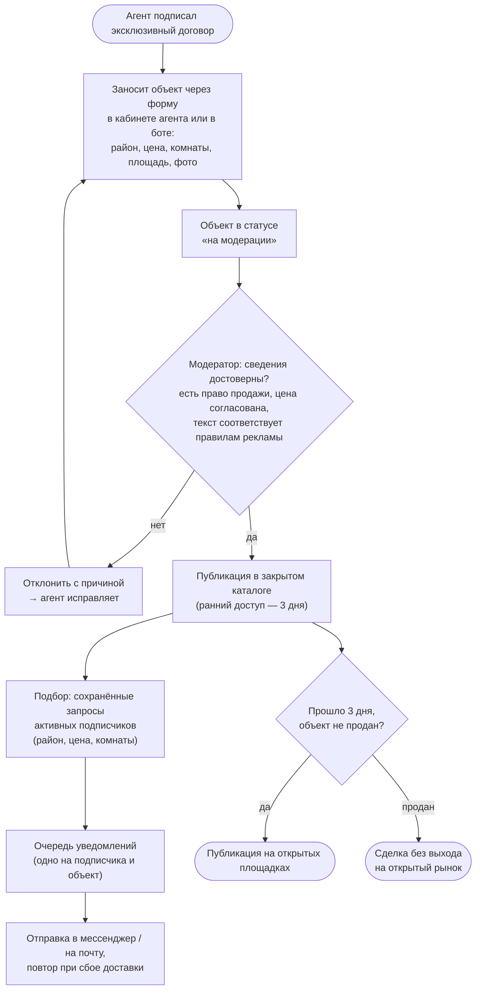
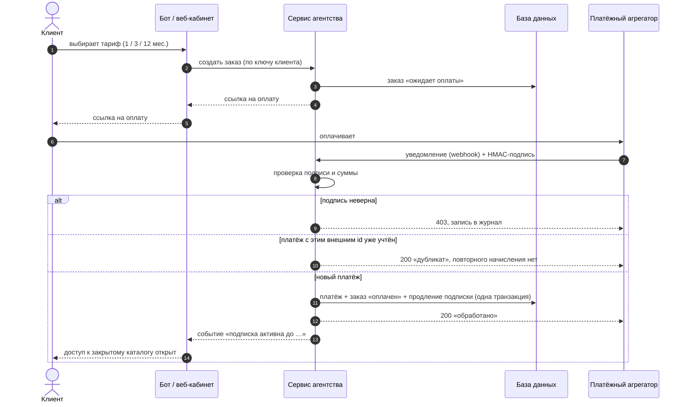
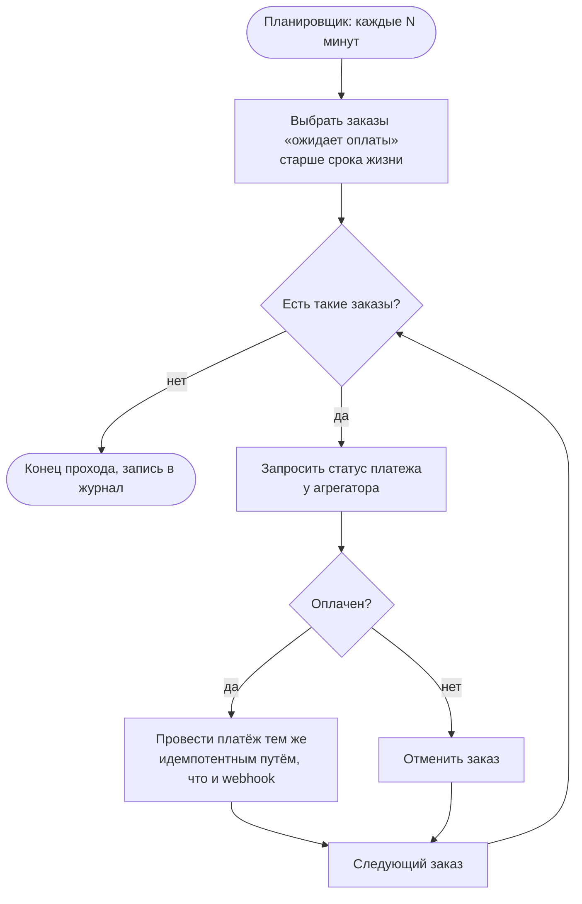
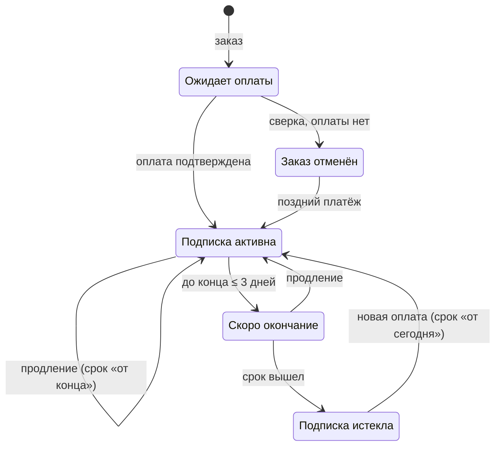
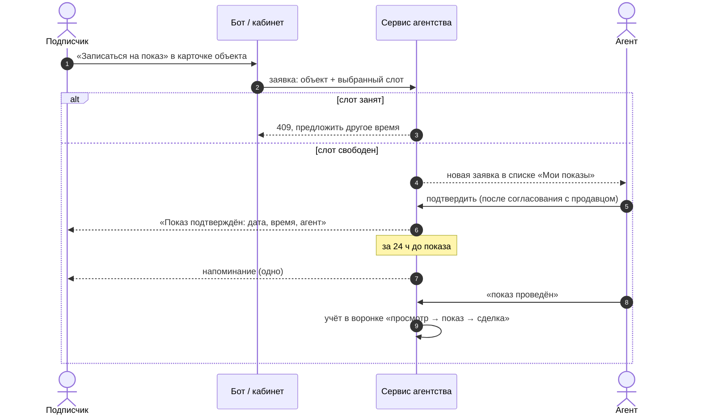
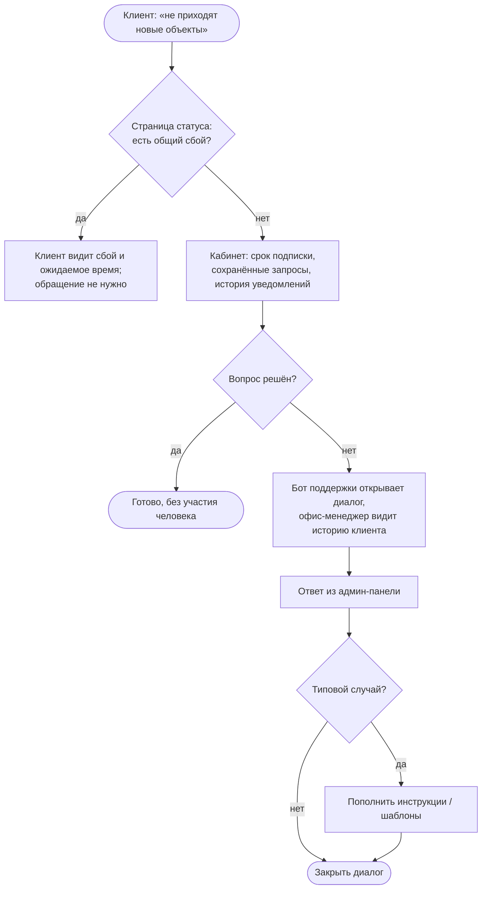
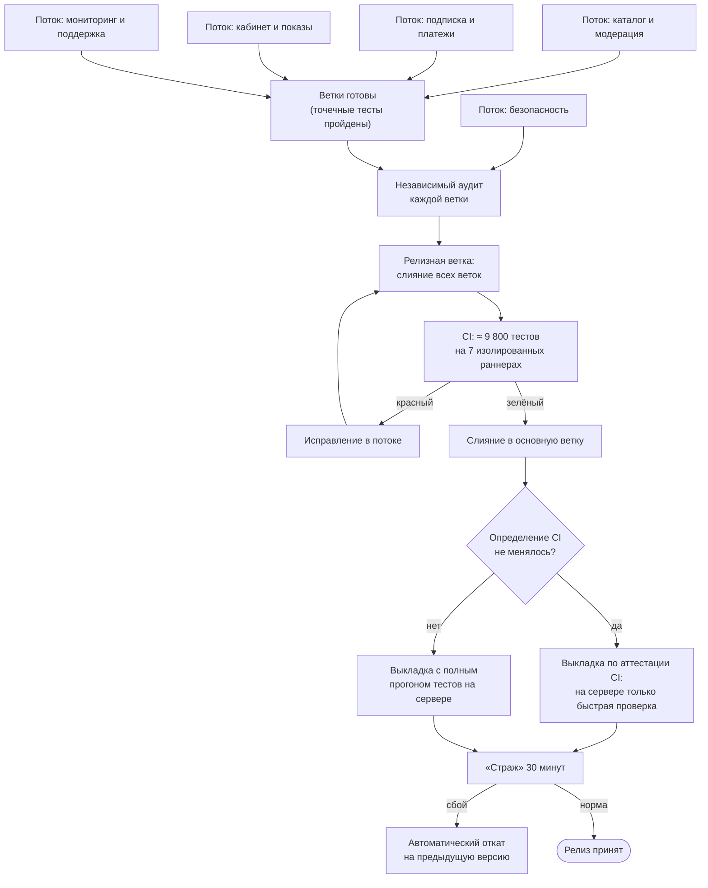
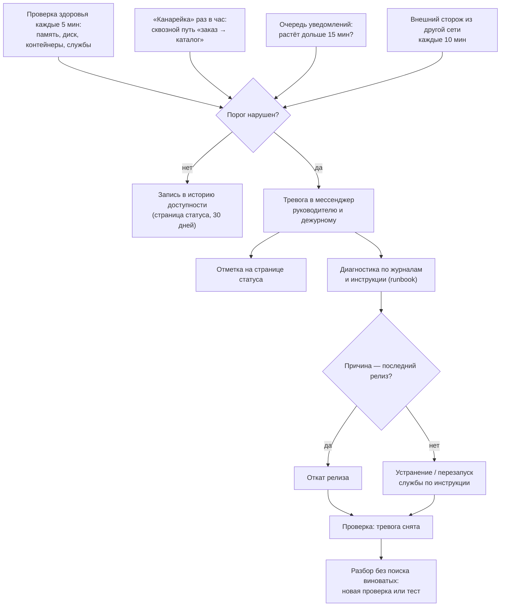
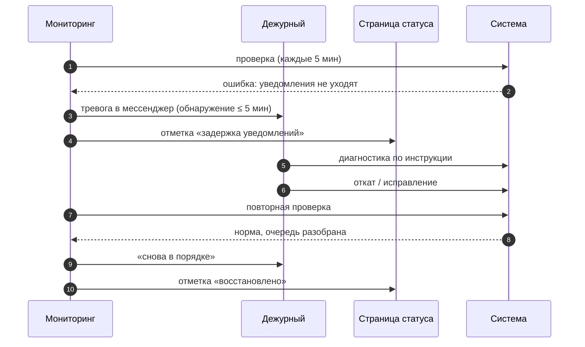

# Глава 2. Целевая модель процессов «как будет»

## 2.1. Принципы проектирования

Целевая модель строилась по шести принципам. Каждый из них — ответ на
конкретную «боль» из главы 1.

1. **Объект существует в одном месте.** Эксклюзив заносится один раз в
   единую базу; каталог, уведомления, показы и отчёты берут сведения
   оттуда, а не из пересланных сообщений.
2. **Человек — на исключениях и на суждении, а не на потоке.** Агент
   решает, какой объект взять и как провести показ; модератор — можно ли
   публиковать сведения. Пересылку, сверку оплат, напоминания и снятие
   доступа делает система.
3. **Каждое событие имеет одного автора и след в журнале.** Платёж связан с
   заказом по идентификатору, публикация объекта — с модератором, правка
   цены — с агентом.
4. **Повтор безопасен.** Любая операция, которую может повторить внешняя
   система (уведомление об оплате) или планировщик (сверка, рассылка),
   идемпотентна: повтор не даёт ни второго начисления, ни второго письма.
5. **Сбой обнаруживает система, а не клиент.** Мониторинг и тревоги —
   обязательная часть процесса, а не «дополнительная функция».
6. **Любое изменение можно откатить.** Выкладка, включение новой функции и
   изменение схемы данных проектируются вместе с процедурой отката.

## 2.2. Процесс «Объект → модерация → закрытый каталог → подписчики»

Это центральный процесс новой модели: именно он превращает эксклюзивы
агентства в ценность подписки.

Ключевые проектные решения:

- **Форма вместо сообщения.** Поля структурированы (район из справочника,
  цена числом, число комнат, площадь), поэтому объект можно искать,
  сравнивать и подбирать под запросы. Проверка значений — на входе: цена
  «7,5 млн» записывается как 7 500 000, «2,5 комнаты» отклоняется.
- **Модерация как контроль достоверности.** Модератор проверяет не стиль
  текста, а то, за что агентство отвечает перед клиентом: наличие
  эксклюзивного договора, согласованную с продавцом цену, соответствие
  объявления требованиям закона о рекламе [27] (для новостроек — сведения
  о застройщике и проектной декларации [30]). Отклонение — всегда с
  причиной, чтобы агент мог исправить.
- **Окно раннего доступа.** Срок, в течение которого объект виден только
  подписчикам, задаётся в настройках (базово — 3 дня) и согласуется с
  продавцом при подписании эксклюзивного договора: продавцу важна скорость
  продажи, и закрытый круг мотивированных покупателей её не замедляет, а
  ускоряет.
- **Подбор по сохранённому запросу.** Подписчик один раз описывает, что
  ищет: район, предельную цену, число комнат. При публикации объекта
  система сама находит всех активных подписчиков, чьи запросы ему
  соответствуют, и ставит уведомления в очередь. Если у подписчика
  несколько подходящих запросов, уведомление всё равно одно.
- **Очередь с повторной доставкой.** Уведомление, которое не удалось
  отправить, остаётся в очереди и уходит при следующем проходе
  планировщика. Время от публикации до доставки измеряется для каждого
  уведомления — это один из KPI главы 5.
- **Только с согласия.** Уведомления получают лишь подписчики, которые
  при оформлении дали согласие на такие сообщения; это требование и закона
  о рекламе (ст. 18 — предварительное согласие на рассылку по сетям
  электросвязи [27]), и закона о персональных данных [26].

## 2.3. Процесс «Заказ подписки → оплата → активация»

Клиент регистрируется по электронной почте или через бота в мессенджере
(ключ или ссылка для входа приходят только на подтверждённый адрес) и
выбирает тариф: 1 месяц — 990 руб., 3 месяца — 2 490 руб., 12 месяцев —
7 990 руб. Условия подписки оформлены как публичная оферта [31]; чек
формирует облачная касса платёжного агрегатора [29]. Поддерживаются две
схемы оплаты: **платёжный агрегатор** (карта и другие способы, уведомление
об оплате приходит на сервер) и **внутренняя валюта мессенджера**
(платёж подтверждает сама платформа мессенджера).

Ключевые проектные решения:

- **Проверка подписи.** Уведомление принимается, только если HMAC-подпись
  тела запроса, посчитанная общим с агрегатором секретом, совпадает с
  присланной [19]. Сравнение — за постоянное время, чтобы не дать подсказки
  атакующему. Платёж валютой мессенджера принимается только с секретом,
  известным платформе.
- **Защита от двойного начисления.** Агрегаторы повторяют уведомления при
  любой сетевой ошибке. Уникальность пары «провайдер + внешний id платежа»
  обеспечивает сама база данных (ограничение уникальности), поэтому даже
  два одновременных уведомления не продлят подписку дважды.
- **Сверка суммы.** Платёж с суммой, отличной от цены тарифа, не
  активирует подписку и попадает в журнал как исключение для разбора.
- **Продление «от конца», а не «от сегодня».** Если подписка ещё действует,
  новый срок прибавляется к дате её окончания: клиент, продливший заранее,
  ничего не теряет.
- **Регистрация без утечек.** Ответ на регистрацию одинаков для нового и
  уже занятого адреса, а ключ доступа в ответ не попадает — он уходит
  письмом. Так по ответу нельзя ни перебирать адреса клиентов агентства, ни
  получить доступ к чужой почте.

### Сверка зависших платежей

Уведомление может не дойти совсем. Поэтому по расписанию запускается
**сверка**: для каждого заказа, который «ожидает оплаты» дольше заданного
срока, сервис запрашивает статус у агрегатора.

Если деньги пришли уже *после* отмены заказа сверкой, подписка всё равно
активируется: клиент заплатил, и это важнее «чистоты» статусов. Случай
отмечается в журнале как «поздний платёж».

### Жизненный цикл подписки

Окончание подписки — тоже автоматическое: за 3 дня до конца срока
подписчик получает одно напоминание с предложением продлить, в момент
окончания доступ к каталогу закрывается, а новые объекты ему больше не
подбираются. Доступ проверяется по сроку непосредственно при каждом
запросе, поэтому он закрывается точно вовремя, даже если плановое задание
ещё не успело перевести подписку в статус «истекла».

Процессы этого и предыдущего раздела реализованы в демонстрационной
программе (`demo/`) и покрыты тестами: неверная подпись, повтор
уведомления, неверная сумма, просроченный заказ, найденный сверкой платёж,
поздний платёж, окончание подписки ровно в срок, подбор только для активных
подписчиков с подходящим запросом.

### Подарочные подписки, промокоды, рефералы

- **Подарочная подписка** — оплаченный одним клиентом срок, который
  активирует другой человек (типичный сценарий — родители, помогающие
  детям с первой квартирой). Код подарка проверяется по криптографической
  подписи сервера, поэтому его нельзя угадать или подделать;
  использование однократное.
- **Промокод** — скидка на тариф с ограничением по сроку и числу
  применений; удобен для совместных акций с застройщиками и банками.
- **Реферальная программа** — подписчик получает персональную ссылку; за
  оплату приглашённого начисляется бонусный срок. Начисление — по факту
  успешной оплаты, тем же транзакционным путём, что и основной платёж.

## 2.4. Процесс «Запись на показ»

Заявка больше не может «утонуть»: она существует как запись с
состоянием («запрошен», «подтверждён», «проведён»), видна агенту в его
списке и руководителю в сводке. Один слот на объект не может быть занят
двумя клиентами — это ограничение уникальности в базе. Напоминание за
сутки отправляется ровно один раз и, по модельной оценке, снижает долю
неявок с 20 до 8 %. Подтвердить или закрыть показ может только агент,
ведущий объект; для чужого агента такой показ просто «не существует».

## 2.5. Процесс «Поддержка клиентов»

Поддержка выделена в **отдельный бот поддержки**, чтобы обращения не
смешивались с заявками на показ. Типовые вопросы закрываются
самообслуживанием: кабинет показывает срок подписки, сохранённые запросы и
историю уведомлений, а публичная страница статуса сервиса отвечает на
вопрос «это у меня или у всех?».

Важная петля обратной связи: каждый повторяющийся вопрос превращается в
пункт инструкции или в шаблон ответа. Например, самый частый вопрос
«почему мне не пришёл объект» в большинстве случаев снимается подсказкой в
кабинете: «ваш запрос: до 6 млн руб., а объект стоит 7,5 млн».

## 2.6. Управленческий учёт и администрирование

Руководитель получает в админ-панели **сводку в реальном времени** вместо
еженедельного устного отчёта:

- воронка «просмотр карточки → заявка на показ → показ → сделка» в целом,
  по агентам и по районам;
- вклад каждого агента: занесённые и опубликованные объекты, показы,
  сделки, комиссия;
- подписка: число активных подписчиков, продления, выручка по каждой схеме
  оплаты;
- время от публикации объекта до уведомления подписчиков.

Доступ к панели разграничен **ролями**: владелец видит всё и управляет
настройками; модератор работает только с очередью объектов; агент видит
свои объекты и показы; офис-менеджер — диалоги поддержки и заказы.
Изменяющие действия фиксируются в **журнале действий** (кто, что, когда);
в журнал не пишутся ключи, токены и адреса почты клиентов — только
идентификаторы.

## 2.7. Процесс «Выкладка релиза»

Разработка ведётся в нескольких параллельных **рабочих потоках по
областям** (каталог и модерация, подписка и платежи, кабинет клиента,
мониторинг и поддержка, безопасность). Исполнители в потоках —
ИИ-ассистенты для разработки; **координатор** (руководитель вместе с
отдельным ассистентом-координатором) собирает готовые изменения в один
релиз, проверяет и выкатывает.

Особенности процесса:

- **Один релиз — один прогон CI.** Мелкие изменения не выкатываются по
  одному: готовые ветки собираются в релиз, что экономит ресурсы CI и время
  координатора.
- **Аттестация CI.** Если определение конвейера (набор шагов, образ
  окружения) не менялось, сервер доверяет результату уже прошедшего
  прогона для того же дерева исходного кода и не повторяет полный набор
  тестов. Выкладка сокращается с десятков минут до 1–2 минут.
- **«Страж».** После выкладки 30 минут работает служба, которая
  периодически проверяет готовность сервиса и сквозной путь клиента
  (каталог открывается подписчику, заказ создаётся). При сбое она
  возвращает предыдущую версию и прежние настройки без участия человека.

## 2.8. Процесс «Мониторинг и управление инцидентами»

Для подписочной модели особенно важна третья проверка: если очередь
уведомлений перестала разбираться, подписчики не получают объекты, за
ранний доступ к которым заплатили, хотя «сайт работает». Разбор инцидента
проводится в формате «без поиска виноватых» (blameless postmortem), как
это принято в практике SRE [10]: результатом является не выговор, а новая
автоматическая проверка или тест.

## 2.9. Резервирование данных

- База данных (объекты, клиенты, подписки, платежи, журнал) и
  конфигурация копируются **ежедневно**.
- Копии **шифруются** до того, как покидают сервер; ключ расшифровки
  хранится отдельно от копий.
- Действует правило «трёх копий»: на сервере, на рабочем ноутбуке
  руководителя и в офисном сетевом хранилище, с разными сроками хранения.
- Регулярно проводятся **учения по восстановлению**: копия
  расшифровывается, база поднимается из неё (около 20 секунд),
  проверяется целостность. Непроверенная копия считается отсутствующей.

## 2.10. Сводка изменений «как есть → как будет»

| Процесс | Как есть | Как будет |
|---|---|---|
| Учёт эксклюзивов | Блокноты, личные таблицы, чаты | Единая база, форма агента, модерация |
| Информирование клиентов | Агент пишет, «если вспомнил» | Автоподбор по сохранённому запросу, очередь уведомлений |
| Продажа доступа | Перевод на карту, скриншот | Подписка 1/3/12 мес., агрегатор или валюта мессенджера, чек |
| Выдача и снятие доступа | Вручную, часы; сроки в таблице | Автоматически сразу после оплаты и точно по сроку |
| Сверка платежей | По выписке | Идемпотентность + сверка по расписанию |
| Показы | Мессенджер, ≈ 15 % заявок теряется | Запись со слотом, подтверждение агентом, напоминание |
| Управленческий учёт | Устный отчёт раз в неделю | Воронка и вклад агентов в реальном времени |
| Администрирование | Прямые правки таблиц | Админ-панель с ролями, журнал действий |
| Выкладка | Ручные правки сайта | Релиз, CI, аттестация, страж и автооткат |
| Мониторинг | Нет | Проверки 5 мин / 1 ч / 10 мин, тревоги, история 30 дней |
| Резервирование | Нерегулярно, без проверки | Ежедневно, шифрование, 3 копии, учения |
