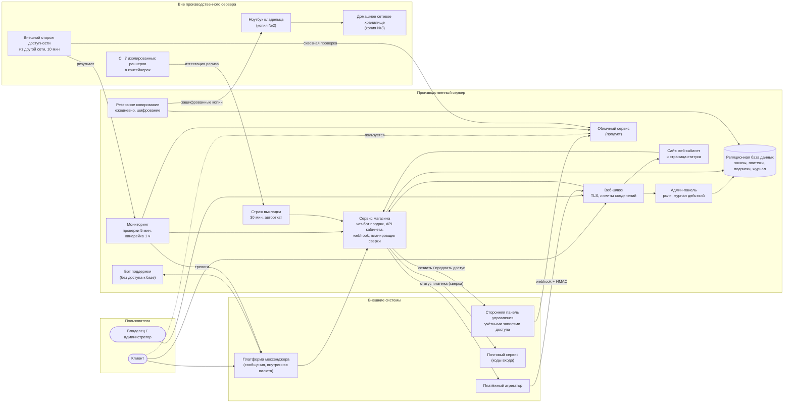
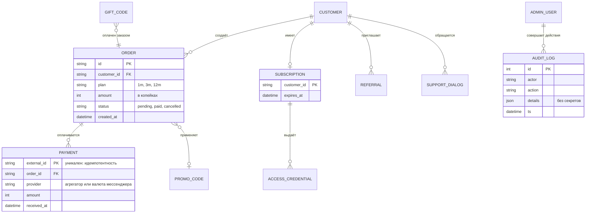

# Глава 3. Архитектура ИТ-решения

## 3.1. Архитектурные принципы

- **Малое число движущихся частей.** Один сервер приложений, одна
  реляционная база данных, каждая служба — в своём контейнере. Для малого
  предприятия простота эксплуатации важнее горизонтального масштабирования.
- **Явные границы доверия.** Всё, что приходит извне (сообщения клиентов,
  уведомления агрегатора, запросы к кабинету), проверяется на границе:
  подпись, сессия, роль, лимиты.
- **Данные — в одном месте.** Источник истины о заказах, платежах и
  подписках — база магазина. Сторонние системы получают из неё производные
  данные и сверяются с ней.
- **Наблюдаемость встроена.** У каждой службы есть проверка готовности, у
  каждого важного действия — запись в журнале.
- **Устойчивость к сбоям соседей.** Обращения к внешним системам выполняются
  с тайм-аутами и повторами, а сбой одной интеграции не должен останавливать
  остальные функции — подход, подробно разобранный М. Найгардом [18].

## 3.2. Схема компонентов (по мотивам модели C4)

Схема соответствует уровню «контейнеров» модели C4 С. Брауна [16]: показаны
развёртываемые части системы и связи между ними.

### Назначение компонентов

| Компонент | Ответственность | Почему отдельно |
|---|---|---|
| Сервис магазина | Каталог тарифов, заказы, оплата, выдача доступа, сверка, промокоды и подарки, рефералы, API кабинета | Ядро бизнес-логики; единственный, кто пишет в основные таблицы |
| Бот поддержки | Диалоги с клиентами | Изолирован: не имеет доступа к базе и секретам магазина — компрометация бота поддержки не даёт доступа к платежам |
| Админ-панель | Просмотр и управление: клиенты, заказы, возвраты, промокоды | Отдельная поверхность атаки с отдельной аутентификацией и ролями |
| Сайт | Веб-кабинет (вход по почте), страница статуса | Статика + тонкий слой API; отдаётся с того же сервера |
| Мониторинг | Проверки здоровья, канарейка, тревоги, история доступности | Должен работать, даже если магазин «упал» — поэтому отдельная служба хоста |
| Страж выкладки | Наблюдение 30 минут после релиза, автооткат | Короткоживущая служба, запускается только при выкладке |
| Резервное копирование | Ежедневные копии, шифрование, ротация | Служба хоста по расписанию |

## 3.3. Модель данных

Принципиальные решения по данным:

- **Деньги — целыми числами** (копейки), а не числами с плавающей точкой.
- **Уникальность внешнего id платежа** обеспечивает СУБД — это единственная
  надёжная защита от двойного начисления при гонке уведомлений.
- **Токены и коды хранятся в виде хешей**; учётные данные доступа, которые
  нужно уметь показать клиенту повторно, — в зашифрованном виде с ключом вне
  базы.
- **Изменения схемы — в два шага** (подготовка → расширение, глава 4), чтобы
  предыдущая версия кода продолжала работать с новой схемой и откат был
  возможен.

## 3.4. Интеграции

| Интеграция | Направление | Механизм | Защита |
|---|---|---|---|
| Платёжный агрегатор | входящая | Webhook (HTTP POST) | HMAC-подпись, проверка суммы, идемпотентность |
| Платёжный агрегатор | исходящая | Запрос статуса платежа (сверка) | Ключ API из хранилища секретов |
| Платформа мессенджера | двусторонняя | Bot API: входящие обновления, отправка сообщений, платежи внутренней валютой | Секретный токен в заголовке входящих обновлений |
| Почтовый сервис | исходящая | API отправки писем с кодом входа | Ключ API; ограничение частоты запросов кода |
| Сторонняя панель учётных записей | исходящая | HTTP API: создать / продлить / отключить доступ | Доступ только из внутренней сети сервера, токен API |
| Внешний сторож | входящая (данные) | Результаты проверок из другой сети | Отдельный ключ с правом только записи результата |

## 3.5. Безопасность

### Модель угроз (кратко)

| Угроза | Мера |
|---|---|
| Подделка уведомления об оплате | HMAC-подпись, сравнение за постоянное время, сверка суммы |
| Повтор уведомления (случайный или злонамеренный) | Идемпотентность по внешнему id на уровне базы |
| Подбор кода входа в кабинет | Ограничение попыток и частоты, короткий срок жизни кода, одинаковые ответы на «нет такого» и «неверно» |
| Компрометация учётной записи администратора | Роли; изменяющие действия разрешены только сессии владельца; журнал всех действий |
| Утечка секретов из настроек | Секреты отделены от обычных настроек и доступны только той службе, которой нужны; ни один секрет не хранится в коде и репозитории |
| Подбор паролей к серверу | Вход только по ключу; автоматический бан атакующих адресов с нарастающим сроком и отправкой жалоб в общую базу злоупотреблений (за неделю — около 1 400 адресов) |
| Ошибка в новом коде | Независимый аудит каждой ветки перед релизом, тесты, страж и автооткат |
| Потеря данных | Шифрованные копии в трёх местах, учения по восстановлению |

### Принципы, применённые в коде

- Секреты — **только из окружения или файла секретов** службы; при их
  отсутствии служба не запускается (так же устроено и демо: без
  `DEMO_WEBHOOK_SECRET` оно отказывается стартовать).
- **Наименьшие привилегии**: контейнеры без лишних системных прав, с
  файловой системой только для чтения там, где это возможно; бот поддержки
  не видит базу.
- **Журнал без секретов**: в журнал действий не пишутся токены, ключи и
  коды (в демо это проверяется тестом).
- Ориентир при проверке веб-части — требования OWASP ASVS [17], при
  построении системы управления ИБ в целом — ISO/IEC 27001 [13].

## 3.6. Инфраструктура разработки

- **Репозиторий** с основной веткой, изменяемой только через запрос на
  слияние (pull request).
- **CI** на выделенной машине: 7 раннеров, каждый в своём непривилегированном
  контейнере со своим окружением; контейнеры изолированы сетевыми правилами
  от самой машины и друг от друга.
- **Около 9 800 автоматических тестов.** Распараллеливание по процессам
  сократило полный прогон в CI с 26 до 12 минут.
- **Стенд** — копия производственной конфигурации для репетиций выкладки,
  миграций схемы и отказов.
- **Карта кода** — автоматически строящийся граф символов и связей
  репозитория, который используют исполнители (люди и ИИ-ассистенты) для
  поиска нужного места в коде вместо сплошного перебора файлов.
