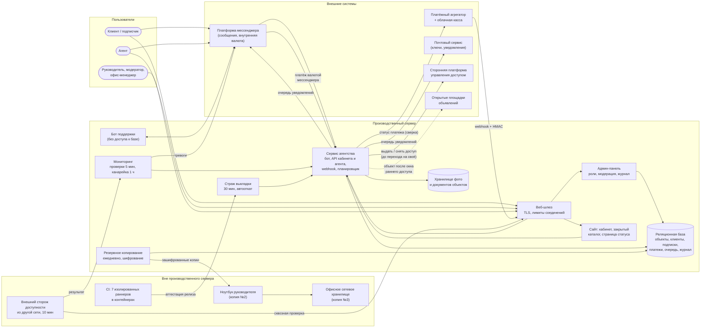
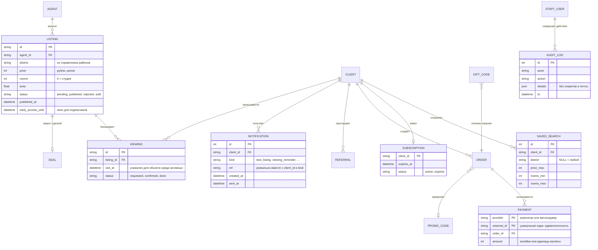

# Глава 3. Архитектура ИТ-решения

## 3.1. Архитектурные принципы

- **Малое число движущихся частей.** Один сервер приложений, одна
  реляционная база данных, каждая служба — в своём контейнере. Для малого
  агентства простота эксплуатации важнее горизонтального масштабирования:
  нагрузка измеряется сотнями подписчиков, а не миллионами.
- **Явные границы доверия.** Всё, что приходит извне (сообщения клиентов,
  уведомления агрегатора, формы агентов, запросы к кабинету),
  проверяется на границе: подпись, ключ или сессия, роль, лимиты, формат
  полей.
- **Данные — в одном месте.** Источник истины об объектах, клиентах,
  подписках и платежах — база агентства. Сторонние системы (платформа
  доступа, площадки объявлений) получают из неё производные данные и
  сверяются с ней.
- **Наблюдаемость встроена.** У каждой службы есть проверка готовности, у
  каждого важного действия — запись в журнале, у каждого уведомления —
  отметка времени постановки и доставки.
- **Устойчивость к сбоям соседей.** Обращения к внешним системам
  выполняются с тайм-аутами и повторами, а сбой одной интеграции (например,
  почтового сервиса) не должен останавливать остальные функции — подход,
  подробно разобранный М. Найгардом [18]. Поэтому уведомления идут через
  очередь, а не отправляются «прямо из» публикации объекта.

## 3.2. Схема компонентов (по мотивам модели C4)

Схема соответствует уровню «контейнеров» модели C4 С. Брауна [16]:
показаны развёртываемые части системы и связи между ними.

### Назначение компонентов

| Компонент | Ответственность | Почему отдельно |
|---|---|---|
| Сервис агентства | Объекты и модерация, закрытый каталог, сохранённые запросы и подбор, заказы и платежи, подписки, показы, сделки, промокоды и подарки, рефералы, API кабинета и агента, планировщик | Ядро бизнес-логики; единственный, кто пишет в основные таблицы |
| Бот поддержки | Диалоги с клиентами | Изолирован: не имеет доступа к базе и секретам — его компрометация не даёт доступа к платежам и персональным данным |
| Админ-панель | Модерация, клиенты, заказы, возвраты, промокоды, сводка для руководителя | Отдельная поверхность атаки с отдельной аутентификацией и ролями |
| Сайт | Кабинет клиента (вход по почте), закрытый каталог, кабинет агента, страница статуса | Статика + тонкий слой API; отдаётся с того же сервера |
| Хранилище файлов | Фото и сканы документов объектов | Файлы не хранятся в базе; документы видят только агент и модератор |
| Мониторинг | Проверки здоровья, канарейка, контроль очереди уведомлений, тревоги, история доступности | Должен работать, даже если сервис «упал», — поэтому отдельная служба хоста |
| Страж выкладки | Наблюдение 30 минут после релиза, автооткат | Короткоживущая служба, запускается только при выкладке |
| Резервное копирование | Ежедневные копии, шифрование, ротация | Служба хоста по расписанию |

## 3.3. Модель данных

Принципиальные решения по данным:

- **Деньги — целыми числами** (копейки, рубли, единицы валюты
  мессенджера), а не числами с плавающей точкой.
- **Уникальность внешнего id платежа** обеспечивает СУБД — единственная
  надёжная защита от двойного начисления при гонке уведомлений.
- **Уникальность уведомления** (клиент + вид + объект) тоже обеспечивает
  СУБД: подписчик с тремя подходящими запросами получит одно сообщение, а
  повторный проход рассылки не продублирует его.
- **Ключи, токены и коды хранятся в виде хешей**; персональные данные —
  только те, что нужны для услуги (почта, идентификатор в мессенджере,
  сохранённые запросы), со сроками хранения по политике обработки
  персональных данных [26].
- **Точный адрес и документы объекта** не входят в карточку закрытого
  каталога: подписчик видит район, цену и параметры, а адрес сообщает
  агент при подтверждении показа. Это защищает продавца и снижает риск
  «увода» объекта.
- **Изменения схемы — в два шага** (подготовка → расширение, глава 4),
  чтобы предыдущая версия кода продолжала работать с новой схемой и откат
  был возможен.

## 3.4. Интеграции

| Интеграция | Направление | Механизм | Защита |
|---|---|---|---|
| Платёжный агрегатор | входящая | Webhook (HTTP POST) | HMAC-подпись, проверка суммы, идемпотентность |
| Платёжный агрегатор | исходящая | Запрос статуса платежа (сверка), чек через облачную кассу | Ключ API из хранилища секретов |
| Платформа мессенджера | двусторонняя | Bot API: входящие обновления, отправка сообщений, платежи внутренней валютой | Секретный токен в заголовке входящих обновлений |
| Почтовый сервис | исходящая | API отправки писем (ключи входа, уведомления) | Ключ API; ограничение частоты; одинаковый ответ на регистрацию |
| Сторонняя платформа доступа | исходящая | HTTP API: выдать / продлить / снять доступ | Только с сервера агентства, токен API; сверка с базой агентства |
| Открытые площадки объявлений | исходящая | Выгрузка объектов после окна раннего доступа (файл-фид или вручную) | Только опубликованные и не проданные объекты, без документов |
| Внешний сторож | входящая (данные) | Результаты проверок из другой сети | Отдельный ключ с правом только записи результата |

## 3.5. Безопасность и защита персональных данных

### Модель угроз (кратко)

| Угроза | Мера |
|---|---|
| Подделка уведомления об оплате | HMAC-подпись, сравнение за постоянное время, сверка суммы |
| Повтор уведомления (случайный или злонамеренный) | Идемпотентность по внешнему id на уровне базы |
| Перебор адресов клиентов через регистрацию | Одинаковый ответ для нового и занятого адреса; ключ только письмом; лимит запросов |
| Подбор кода входа в кабинет | Ограничение попыток и частоты, короткий срок жизни кода |
| Доступ к закрытому каталогу без подписки | Проверка срока подписки при каждом запросе, а не только плановым заданием |
| Массовая выгрузка каталога подписчиком для перепродажи | Лимит частоты запросов, водяные знаки на фото, журнал просмотров, отключение нарушителя по оферте |
| Агент меняет чужой объект или подтверждает чужой показ | Проверка принадлежности объекта; для чужого агента запись «не существует» (404) |
| Компрометация учётной записи сотрудника | Роли; изменяющие настройки действия — только у сессии владельца; журнал всех действий |
| Утечка персональных данных клиентов | Минимизация данных, журнал без почты, бот поддержки без доступа к базе, шифрование копий |
| Утечка секретов из настроек | Секреты отделены от обычных настроек и доступны только той службе, которой нужны; в коде и репозитории их нет |
| Подбор паролей к серверу | Вход только по ключу; автоматическая блокировка атакующих адресов с нарастающим сроком |
| Ошибка в новом коде | Независимый аудит каждой ветки перед релизом, тесты, страж и автооткат |
| Потеря данных | Шифрованные копии в трёх местах, учения по восстановлению |

### Требования к обработке персональных данных

Агентство обрабатывает персональные данные клиентов (почта, телефон,
идентификатор в мессенджере, сведения о том, какое жильё человек ищет) и
продавцов, поэтому является оператором в смысле закона № 152-ФЗ [26]. Для
архитектуры это означает:

- согласие клиента на обработку данных и отдельное согласие на рассылку
  получаются при оформлении подписки и хранятся с отметкой времени;
- база с персональными данными граждан РФ размещается на территории РФ
  (требование локализации, ст. 18 ч. 5 закона [26]);
- для каждой категории данных определён срок хранения; журналы и
  резервные копии хранятся ограниченное время;
- доступ сотрудников разграничен ролями, действия журналируются, —
  это часть организационных и технических мер защиты (ст. 18.1 и 19
  закона [26]).

### Принципы, применённые в коде

- Секреты — **только из окружения или файла секретов** службы; при их
  отсутствии служба не запускается (так же устроено и демо: без
  `DEMO_WEBHOOK_SECRET` оно отказывается стартовать).
- **Наименьшие привилегии**: контейнеры без лишних системных прав, с
  файловой системой только для чтения там, где возможно; бот поддержки не
  видит базу; модератор не видит журнал и настройки.
- **Журнал без секретов и почты**: в журнал действий не пишутся токены,
  ключи и адреса клиентов (в демо это проверяется тестом).
- Ориентир при проверке веб-части — требования OWASP ASVS [17], при
  построении системы управления ИБ в целом — ISO/IEC 27001 [13].

## 3.6. Инфраструктура разработки

- **Репозиторий** с основной веткой, изменяемой только через запрос на
  слияние (pull request).
- **CI** на выделенной машине: 7 раннеров, каждый в своём
  непривилегированном контейнере со своим окружением; контейнеры
  изолированы сетевыми правилами от самой машины и друг от друга.
- **Около 9 800 автоматических тестов** (модульные, интеграционные,
  сквозные, проверки сценариев выкладки). Распараллеливание по процессам
  сократило полный прогон в CI с 26 до 12 минут.
- **Стенд** — копия производственной конфигурации для репетиций выкладки,
  миграций схемы и переключения на собственную платформу доступа.
- **Карта кода** — автоматически строящийся граф символов и связей
  репозитория, которым пользуются исполнители (люди и ИИ-ассистенты) для
  поиска нужного места в коде вместо сплошного перебора файлов.
