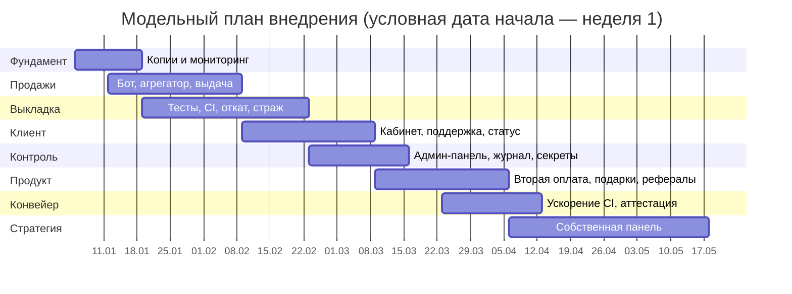
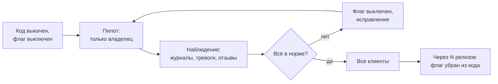
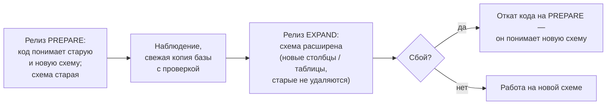
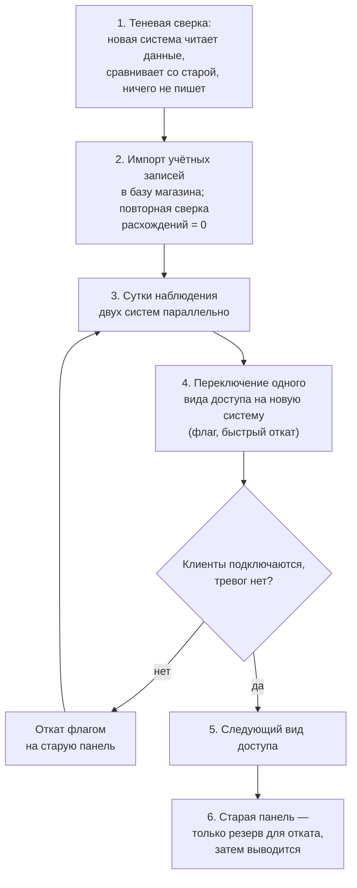

# Глава 4. План и этапы внедрения

## 4.1. Логика очерёдности

Порядок этапов определяется двумя соображениями: где больше всего ручного
труда (глава 1: заказ-оплата-выдача — 54 % трудозатрат) и что нужно, чтобы
следующие изменения были безопасными. Поэтому «фундамент» — резервирование,
мониторинг и тесты — закладывается параллельно с первой автоматизацией, а не
после неё.

| Этап | Содержание | Результат | Критерий завершения |
|---|---|---|---|
| 0. Фундамент | Регулярные шифрованные копии, проверка восстановления; базовый мониторинг памяти, диска и служб; тревоги в мессенджер | Можно восстановиться и узнать о сбое раньше клиента | Учение по восстановлению пройдено; тестовая тревога доставлена |
| 1. Автоматизация продаж | Чат-бот продаж, платёжный агрегатор с webhook, автоматическая выдача доступа, сверка зависших платежей | Типовой заказ проходит без участия человека | Доля заказов без ручного вмешательства ≥ 90 % в течение 2 недель |
| 2. Безопасная выкладка | Автоматические тесты, CI, процедура отката, страж после выкладки | Изменения можно выкатывать часто и без страха | Каждый релиз проходит CI; откат проверен на стенде |
| 3. Самообслуживание и поддержка | Веб-кабинет со входом по почте, бот поддержки, страница статуса | Снижение числа обращений, история по клиенту | Число обращений на заказ снизилось; страница статуса показывает 30 дней |
| 4. Управление и контроль | Админ-панель с ролями, журнал действий, отделение секретов от настроек, защита входа | Прозрачность и подотчётность | Все изменяющие действия видны в журнале |
| 5. Расширение продукта | Вторая платёжная схема (валюта мессенджера), подарочные коды, промокоды, рефералы | Новые каналы выручки | Функции включены для всех клиентов |
| 6. Ускорение конвейера | Распараллеливание тестов, изолированные раннеры, выкладка по аттестации CI | Цикл «изменение → прод» сокращён | Полный прогон CI ≤ 15 мин; выкладка без повторного прогона ≤ 2 мин |
| 7. Уход от вендорной зависимости | Собственная панель управления учётными записями доступа вместо сторонней | Контроль над ключевым компонентом | См. п. 4.6 |

Даты условные (модельный календарь из 19 недель), сроки оценочные: этапы частично перекрываются, потому что работы ведутся в
нескольких параллельных потоках (см. п. 4.3).

## 4.2. Управление изменениями

Классическая модель Дж. Коттера [15] описывает изменения в организации через
создание ощущения необходимости, коалицию сторонников и закрепление
результатов в культуре. Для предприятия из одного человека «коалиция» и
«культура» выглядят иначе, но суть сохраняется:

- **Необходимость** обоснована цифрами главы 1: 130 часов рутины в месяц и
  сбои, о которых узнают от клиентов.
- **Быстрые победы.** Первым автоматизирован самый болезненный для клиента
  шаг — ожидание доступа после оплаты. Эффект заметен в первый же день и
  укрепляет доверие к дальнейшим изменениям.
- **Изменения для клиентов — постепенно.** Каждая новая функция сначала
  включается на владельце (пилот), затем на небольшой группе, затем на всех
  (п. 4.4). Клиенты не становятся испытателями.
- **Закрепление.** Правила работы зафиксированы письменно: инструкции
  выкладки и отката (runbook), журнал решений, перечень действий, требующих
  явного согласия владельца (изменение схемы базы, удаление данных, смена
  секретов, перезагрузка сервера).

## 4.3. Организация работ: параллельные потоки и координатор

Особенность кейса — исполнителями в разработке выступают **ИИ-ассистенты**,
каждый из которых закреплён за своей областью:

| Поток | Область |
|---|---|
| Платежи | Оплата, сверка, подарки, промокоды, админ-панель |
| Кабинет | Веб-кабинет, раздел устройств, интерфейс клиента |
| Доступность | Сайт, страница статуса, внешний сторож, документация |
| Мониторинг | Проверки здоровья, бот поддержки, тревоги |
| Безопасность | Независимый аудит веток, защита входа, секреты |

**Координатор** распределяет задачи, проверяет результаты, собирает релиз и
выкатывает его. Владелец принимает продуктовые решения и даёт явное «да» на
необратимые или рискованные действия.

Правила, которые сделали такую организацию работоспособной:

1. **Работа — в отдельных ветках по областям**, основная ветка меняется
   только через слияние релиза.
2. **Независимый аудит.** Ветку проверяет не тот исполнитель, который её
   писал; поток безопасности просматривает каждое изменение перед релизом.
3. **Один релиз — один прогон CI.** Готовые ветки объединяются в релизную,
   проходят полный набор тестов и выкатываются одним действием.
4. **Явные границы полномочий.** Перечень действий, на которые исполнитель
   не имеет права без согласия владельца, записан и одинаков для всех потоков.
5. **Доказательства, а не уверения.** Отчёт исполнителя содержит результаты
   тестов и проверок, которые координатор может воспроизвести.

## 4.4. Флаги функций и пилоты

Каждая значимая функция включается **флагом** (переключателем в настройках)
[11]. Типичная последовательность:

Преимущества: выкладка кода отделена от включения функции; откат функции —
это изменение одной строки настроек без новой выкладки; рискованная функция
проверяется на реальных условиях без риска для клиентов. Так, например,
включались оплата внутренней валютой мессенджера (сначала владелец, затем все)
и подарочные коды.

## 4.5. Стенд, миграции схемы и откаты

### Стенд

Перед выкладкой рискованных изменений (новый сценарий выкладки, изменение
схемы базы, переезд компонента) проводится **репетиция на стенде** — копии
производственной конфигурации. Результаты репетиции сохраняются как
доказательства и прикладываются к описанию релиза.

### Миграции схемы в два шага

Изменение схемы базы данных опасно тем, что после него откат кода может
стать невозможным. Поэтому применяется приём «параллельного изменения»
(expand / contract) [12]:

Перед шагом EXPAND делается ручная копия базы, проверяется её
восстановление, и только после этого схема меняется. Каждая такая выкладка
сначала репетируется на стенде.

### Откаты

| Что меняется | Как откатить | Время |
|---|---|---|
| Версия приложения | Страж автоматически, либо вручную на предыдущий образ (хранятся текущий и предыдущий) | минуты |
| Функция | Выключить флаг | секунды – минуты |
| Настройки | Вернуть сохранённую перед изменением копию файла настроек | минуты |
| Сетевые правила | Страховочный таймер, который сам вернёт прежние правила, если изменение не подтверждено | автоматически через N минут |
| Схема базы | Откат кода на версию PREPARE; восстановление из копии — крайняя мера | минуты / десятки минут |

Общее правило для любого изменения в производственной среде:
**снять текущее состояние → подготовить и проверить откат → применить
минимальное изменение → проверить результат.**

## 4.6. Стратегический проект: замена сторонней панели

Учётные записи доступа клиентов к облачному сервису сейчас ведутся в
**сторонней панели управления**. Опыт эксплуатации выявил её недостатки:
утечки памяти и аварийные перезапуски, ограниченный API, изменения поведения
между версиями, на которые предприятие не может повлиять. Это классическая
**вендорная зависимость** в ключевом звене цепочки создания ценности.

Цель проекта — перенести управление учётными записями в собственный
компонент, для которого источником истины является база магазина. Подход —
постепенная замена по образцу «душителя» (strangler fig) М. Фаулера [21]:
новая система обрастает функциями рядом со старой, пока старая не перестаёт
быть нужной.

Ключевые условия безопасности проекта: старая панель сохраняется как цель
отката до полного завершения; на каждом шаге есть автоматическая проверка
«клиент действительно может подключиться»; переключение выполняется, когда
владелец может сам проверить работу с клиентского устройства.
