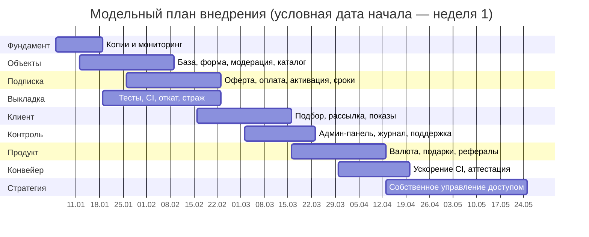
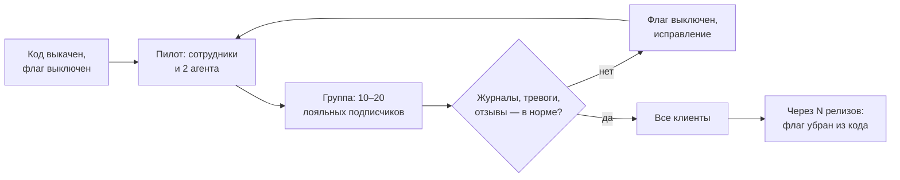
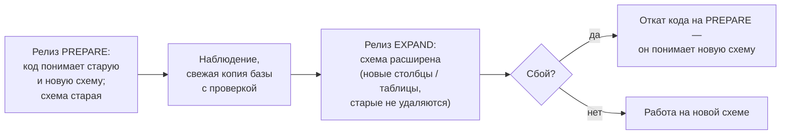
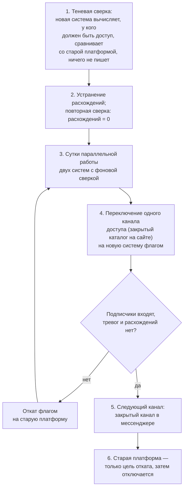

# Глава 4. План и этапы внедрения

## 4.1. Логика очерёдности

Порядок этапов определяется тремя соображениями. Во-первых, без единой
базы объектов подписке нечего продавать — значит, база идёт первой.
Во-вторых, больше всего ручного труда уходит на цепочку «объект → клиент →
показ» (глава 1: 72 ч/мес, 55 % трудозатрат). В-третьих, следующие
изменения должны быть безопасными, поэтому «фундамент» — резервирование,
мониторинг и тесты — закладывается параллельно с первой автоматизацией, а
не после неё.

| Этап | Содержание | Результат | Критерий завершения |
|---|---|---|---|
| 0. Фундамент | Ежедневные шифрованные копии, проверка восстановления; мониторинг памяти, диска и служб; тревоги в мессенджер | Можно восстановиться и узнать о сбое раньше клиента | Учение по восстановлению пройдено; тестовая тревога доставлена |
| 1. Единая база объектов | Форма агента, справочник районов, модерация, закрытый каталог; перенос текущих эксклюзивов из блокнотов и чатов | Все эксклюзивы в одном месте | 100 % новых эксклюзивов заносятся через форму 2 недели подряд |
| 2. Подписка | Оферта, согласия, тарифы 1/3/12 мес., агрегатор с webhook и чеком, автоматическая активация и окончание, сверка зависших платежей; перевод 40 клиентов «закрытого доступа» на подписку | Подписка продаётся и обслуживается без участия офис-менеджера | Доля заказов без ручного вмешательства ≥ 95 % за 2 недели |
| 3. Безопасная выкладка | Автоматические тесты, CI, процедура отката, страж после выкладки | Изменения можно выкатывать часто и без страха | Каждый релиз проходит CI; откат проверен на стенде |
| 4. Подбор и показы | Сохранённые запросы, очередь уведомлений, запись на показ со слотами и напоминаниями | Ранний доступ работает «как обещано» | 95 % уведомлений доставлены ≤ 2 ч после поступления объекта на модерацию |
| 5. Управление и поддержка | Админ-панель с ролями, журнал действий, сводка руководителю; бот поддержки, страница статуса | Прозрачность и самообслуживание | Устный отчёт отменён; число обращений на подписчика снизилось |
| 6. Расширение продукта | Оплата внутренней валютой мессенджера, подарочные подписки, промокоды, реферальная программа | Новые каналы продаж подписки | Функции включены для всех клиентов |
| 7. Ускорение конвейера | Распараллеливание тестов, изолированные раннеры, выкладка по аттестации CI | Цикл «изменение → прод» сокращён | Полный прогон CI ≤ 15 мин; выкладка без повторного прогона ≤ 2 мин |
| 8. Уход от вендорной зависимости | Собственное управление доступом вместо сторонней платформы | Контроль над ключевым звеном подписки | См. п. 4.7 |

Даты условные (модельный календарь из 20 недель), сроки оценочные: этапы
частично перекрываются, потому что работы ведутся в нескольких
параллельных потоках (п. 4.3). Первые шесть месяцев модели в главе 5
соответствуют периоду внедрения и набора подписчиков.

## 4.2. Управление изменениями

Модель Дж. Коттера [15] описывает изменения через создание ощущения
необходимости, коалицию сторонников, быстрые победы и закрепление
результатов в культуре. В агентстве недвижимости у этой модели есть
особенность: главные участники изменений — агенты, которые работают на
комиссии и привыкли считать эксклюзив «своим». Общая база объектов
поначалу воспринимается ими как угроза: «занесу объект — его продаст
коллега».

Поэтому план изменений строится вокруг интересов агента:

- **Необходимость** обоснована цифрами главы 1: 72 часа в месяц агенты
  тратят на пересылку сообщений и согласование показов вместо самих
  показов, а 15 % заявок теряется.
- **Объект закреплён за агентом.** В базе у каждого объекта есть
  ответственный агент; заявки на показ приходят только ему, а сводка
  руководителя показывает его вклад — объекты, показы, сделки, комиссию.
  Общая база не «отнимает» объект, а делает работу агента видимой.
- **Быстрые победы.** Первым автоматизирован самый болезненный для агента
  шаг — разбор заявок на показ в мессенджере. Эффект заметен в первую же
  неделю.
- **Коалиция.** Пилот начинается с двух агентов, которые сами предложили
  попробовать; их результаты в сводке становятся аргументом для остальных.
  Обучение — около 5 часов на агента, с инструкциями в самом кабинете.
- **Изменения для клиентов — постепенно.** Каждая новая функция сначала
  включается на сотрудниках, затем на небольшой группе лояльных
  подписчиков, затем на всех (п. 4.4).
- **Закрепление.** Правила работы зафиксированы письменно: эксклюзив без
  карточки в базе не считается принятым в работу; инструкции модерации,
  выкладки и отката; перечень действий, требующих явного согласия
  руководителя (изменение схемы базы, удаление данных, смена секретов,
  перезагрузка сервера).

## 4.3. Организация работ: параллельные потоки и координатор

Особенность кейса — исполнителями в разработке выступают
**ИИ-ассистенты**, каждый из которых закреплён за своей областью:

| Поток | Область |
|---|---|
| Каталог и модерация | Форма агента, модерация, закрытый каталог, справочники |
| Подписка и платежи | Заказы, оплата, сверка, сроки, подарки, промокоды, админ-панель |
| Кабинет и показы | Кабинет клиента, сохранённые запросы, уведомления, запись на показ |
| Мониторинг и поддержка | Проверки здоровья, бот поддержки, тревоги, страница статуса |
| Безопасность | Независимый аудит веток, защита входа, секреты, персональные данные |

**Координатор** распределяет задачи, проверяет результаты, собирает релиз
и выкатывает его. Руководитель агентства принимает продуктовые решения и
даёт явное «да» на необратимые или рискованные действия.

Правила, которые сделали такую организацию работоспособной:

1. **Работа — в отдельных ветках по областям**, основная ветка меняется
   только через слияние релиза.
2. **Независимый аудит.** Ветку проверяет не тот исполнитель, который её
   писал; поток безопасности просматривает каждое изменение перед
   релизом. Пример находки аудита — исходный вариант регистрации отвечал
   по-разному для нового и занятого адреса и возвращал ключ прямо в ответе,
   что позволяло перебирать почты клиентов; исправление (одинаковый ответ,
   ключ только письмом) вошло в тот же релиз.
3. **Один релиз — один прогон CI.** Готовые ветки объединяются в релизную,
   проходят полный набор тестов и выкатываются одним действием.
4. **Явные границы полномочий.** Перечень действий, на которые исполнитель
   не имеет права без согласия руководителя, записан и одинаков для всех
   потоков.
5. **Доказательства, а не уверения.** Отчёт исполнителя содержит
   результаты тестов и проверок, которые координатор может воспроизвести.

## 4.4. Флаги функций и пилоты

Каждая значимая функция включается **флагом** (переключателем в
настройках) [11]. Типичная последовательность:

Преимущества: выкладка кода отделена от включения функции; откат функции —
изменение одной строки настроек без новой выкладки; рискованная функция
проверяется в реальных условиях без риска для всех клиентов. Так
включались, например, автоматическая рассылка подписчикам (сначала на
сотрудниках — чтобы проверить качество подбора и не «заспамить» клиентов),
оплата валютой мессенджера и подарочные подписки. Такой подход близок к
идее минимально жизнеспособного продукта и проверяемых гипотез
Э. Риса [33].

Отдельный пилот — **перевод 40 клиентов «закрытого доступа»** на новую
подписку: каждому оставшийся оплаченный срок перенесён вручную (единственная
ручная операция этапа, выполнена один раз), а при первой оплате новой
подписки предложен бонусный месяц за переход на тариф 3 или 12 месяцев.

## 4.5. Стенд, миграции схемы и откаты

### Стенд

Перед выкладкой рискованных изменений (новый сценарий выкладки, изменение
схемы базы, переключение платформы доступа) проводится **репетиция на
стенде** — копии производственной конфигурации с обезличенными данными.
Результаты репетиции сохраняются как доказательства и прикладываются к
описанию релиза.

### Миграции схемы в два шага

Изменение схемы базы опасно тем, что после него откат кода может стать
невозможным. Поэтому применяется приём «параллельного изменения»
(expand / contract) [12]:

Пример: добавление сохранённых запросов подписчиков. Релиз PREPARE учит
код работать и с таблицей запросов, и без неё; релиз EXPAND создаёт
таблицу. Перед шагом EXPAND делается ручная копия базы и проверяется её
восстановление.

### Откаты

| Что меняется | Как откатить | Время |
|---|---|---|
| Версия приложения | Страж автоматически, либо вручную на предыдущий образ (хранятся текущий и предыдущий) | минуты |
| Функция | Выключить флаг | секунды – минуты |
| Настройки | Вернуть сохранённую перед изменением копию файла настроек | минуты |
| Сетевые правила | Страховочный таймер, который сам вернёт прежние правила, если изменение не подтверждено | автоматически через N минут |
| Схема базы | Откат кода на версию PREPARE; восстановление из копии — крайняя мера | минуты / десятки минут |
| Платформа доступа | Флаг на старую платформу, которая сохраняется до конца проекта | минуты |

Общее правило для любого изменения в производственной среде:
**снять текущее состояние → подготовить и проверить откат → применить
минимальное изменение → проверить результат.**

## 4.6. Сопровождение после внедрения

- **Модерация** — ежедневная обязанность офис-менеджера (≈ 5 минут на
  объект) с правом руководителя на финальное решение в спорных случаях.
- **Еженедельный обзор сводки** руководителем вместе с агентами: воронка,
  объекты без показов дольше 10 дней, причины отклонений на модерации.
- **Ежемесячное учение по восстановлению** и разбор всех тревог за месяц.
- **Ежеквартальный пересмотр** тарифов, окна раннего доступа и условий
  оферты по фактическим данным о продлениях.

## 4.7. Стратегический проект: собственное управление доступом

На этапах 2–7 доступ подписчиков к закрытому каналу в мессенджере
выдаётся и снимается через **стороннюю платформу управления доступом**
(сервис платных закрытых сообществ): сервис агентства после оплаты
вызывает её API. Опыт эксплуатации выявил недостатки: комиссия платформы с
каждого платежа, ограниченный API, сбои и изменения поведения между
версиями, на которые агентство не может повлиять, и то, что часть данных о
подписчиках хранится у третьей стороны. Это классическая **вендорная
зависимость** в ключевом звене цепочки создания ценности.

Цель проекта — перенести управление доступом в собственный компонент, для
которого источником истины является база агентства. Подход — постепенная
замена по образцу «душителя» (strangler fig) М. Фаулера [21]: новая
система обрастает функциями рядом со старой, пока старая не перестаёт быть
нужной.

Ключевые условия безопасности проекта: старая платформа сохраняется как
цель отката до полного завершения; на каждом шаге есть автоматическая
проверка «подписчик действительно видит каталог, а истёкший — нет»;
переключение выполняется в рабочее время, когда руководитель может сам
проверить вход с клиентского устройства.
