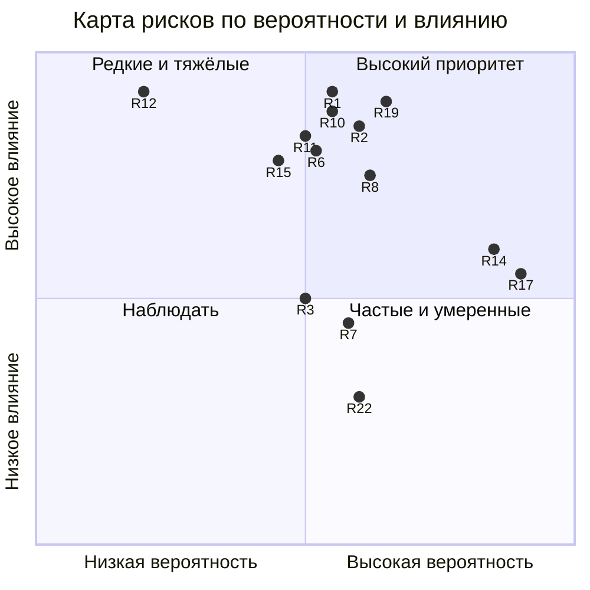

# Глава 6. Риски и меры по их снижению

## 6.1. Методика

Риски оценены экспертно по двум шкалам от 1 до 3: **вероятность** (В) и
**влияние** (Вл). Уровень риска = В × Вл: 1–2 — низкий, 3–4 — средний,
6–9 — высокий. Для каждого риска указаны меры **предупреждения** (снижают
вероятность) и **реагирования** (снижают влияние, если риск реализовался).
Риски сгруппированы: правовые и репутационные, бизнес-модели,
технологические, организационные.

## 6.2. Реестр рисков

### Правовые и репутационные

| № | Риск | В | Вл | Уровень | Предупреждение | Реагирование |
|---|---|---|---|---|---|---|
| Р1 | Утечка персональных данных клиентов (почта, телефон, что и за сколько ищет человек) | 2 | 3 | 6 высокий | Минимизация данных, роли, журнал без почты, бот поддержки без доступа к базе, шифрование копий, хранение в РФ [26] | Порядок реагирования на инцидент с ПДн, уведомление уполномоченного органа и субъектов в установленные законом сроки, отзыв ключей |
| Р2 | Недостоверные сведения об объекте в закрытом каталоге (цена, площадь, право продажи) | 2 | 3 | 6 высокий | Обязательная модерация с чек-листом: эксклюзивный договор, согласованная цена, документы; ответственный агент у каждого объекта | Снятие объекта с публикации, уведомление подписчиков, получивших его, об исправлении; разбор с агентом |
| Р3 | Нарушение требований к рекламе: объявления о новостройках без обязательных сведений, рассылки без согласия | 2 | 2 | 4 средний | Шаблон карточки новостройки со сведениями о застройщике и проектной декларации (ст. 28 закона о рекламе [27], закон о долевом строительстве [30]); уведомления только с согласия (ст. 18 [27]) | Остановка рассылки флагом, исправление шаблона, ответ на предписание |
| Р4 | Претензии подписчиков: «ранний доступ не дал результата», отказ от подписки, возврат | 2 | 1 | 2 низкий | Ясная оферта: что входит в подписку и что не гарантируется [31]; право отказа с возвратом за неиспользованный срок (ст. 32 закона о защите прав потребителей [28]) | Возврат из админ-панели, запись в журнал; разбор причин отказов |
| Р5 | Конфликт интересов с продавцом: окно раннего доступа задерживает выход объекта на рынок | 1 | 2 | 2 низкий | Окно согласуется в эксклюзивном договоре; продавец видит статистику просмотров и заявок | Досрочный выход на открытые площадки по просьбе продавца |

### Бизнес-модели

| № | Риск | В | Вл | Уровень | Предупреждение | Реагирование |
|---|---|---|---|---|---|---|
| Р6 | Подписчиков меньше плана (≈ 120 — порог окупаемости в консервативном варианте) | 2 | 3 | 6 высокий | Пилот на лояльных клиентах, продвижение, подарки и рефералы, тариф на 12 мес. со скидкой | Пересмотр цены и окна раннего доступа; проект и без подписки окупается за счёт времени (глава 5) |
| Р7 | «Слив» закрытого каталога в открытые чаты, перепродажа доступа | 2 | 2 | 4 средний | Карточка без точного адреса, водяные знаки на фото, лимиты запросов, журнал просмотров | Отключение нарушителя по оферте; анализ журнала просмотров |
| Р8 | Зависимость от открытых площадок объявлений (правила, цены размещения, блокировка аккаунта) | 2 | 3 | 6 высокий | Собственный канал клиентов — подписка и база запросов; выгрузка на несколько площадок | Перераспределение размещения; подписчики получают объекты независимо от площадок |
| Р9 | Зависимость от мессенджера, агрегатора, почтового сервиса | 2 | 3 | 6 высокий | Две независимые схемы оплаты; веб-кабинет и почта как каналы, не зависящие от мессенджера | Перевод клиентов на работающий канал; информирование через страницу статуса |

Зависимость от площадок — классический риск «платформенной экономики»,
разобранный Дж. Паркером, М. Ван Алстином и С. Чаудари [24]: тот, кто
владеет площадкой, владеет и отношениями с клиентом. Подписка с
сохранёнными запросами — способ вернуть эти отношения агентству.

### Технологические

| № | Риск | В | Вл | Уровень | Предупреждение | Реагирование |
|---|---|---|---|---|---|---|
| Р10 | Ошибка в новой версии останавливает продажи или рассылку | 2 | 3 | 6 высокий | ≈ 9 800 тестов в CI, независимый аудит веток, репетиция на стенде | Страж 30 мин и автооткат; хранится предыдущий образ |
| Р11 | Двойное начисление или потеря платежа | 2 | 3 | 6 высокий | Идемпотентность по внешнему id на уровне базы, проверка подписи и суммы | Сверка зависших платежей по расписанию; журнал для разбора |
| Р12 | Потеря или повреждение базы объектов и клиентов | 1 | 3 | 3 средний | Ежедневные шифрованные копии в трёх местах | Учения по восстановлению (≈ 20 с); проверенный порядок восстановления |
| Р13 | Потеря ключа шифрования копий | 1 | 3 | 3 средний | Ключ хранится отдельно от копий, есть вторая копия у руководителя | Регулярная проверка расшифровки копии |
| Р14 | Сбой или изменение API сторонней платформы доступа | 3 | 2 | 6 высокий | Мониторинг её ответов, сверка выданных доступов с базой агентства | Повтор операций; стратегически — собственное управление доступом (п. 4.7) |
| Р15 | Сбой при переключении на собственное управление доступом | 2 | 3 | 6 высокий | Теневая сверка, сутки параллельной работы, поканальное переключение | Откат флагом на старую платформу, которая сохраняется до конца проекта |
| Р16 | Миграция схемы базы делает откат невозможным | 1 | 3 | 3 средний | Два шага PREPARE → EXPAND, репетиция на стенде | Ручная копия перед EXPAND с проверкой восстановления |
| Р17 | Атаки на сервер и кабинет (подбор паролей, перебор адресов, сканирование) | 3 | 2 | 6 высокий | Вход на сервер только по ключу, одинаковый ответ на регистрацию, лимиты частоты, сетевой экран | Автоматическая блокировка атакующих адресов; журнал для расследования |
| Р18 | Компрометация учётной записи сотрудника | 1 | 3 | 3 средний | Роли, изменения настроек только у владельца, защита входа от подбора кода | Журнал действий, отзыв сессий, смена секретов |

### Организационные

| № | Риск | В | Вл | Уровень | Предупреждение | Реагирование |
|---|---|---|---|---|---|---|
| Р19 | Сопротивление агентов: эксклюзивы не заносятся в общую базу | 2 | 3 | 6 высокий | Объект закреплён за агентом, его вклад виден в сводке; правило «нет карточки — объект не в работе»; пилот с добровольцами | Разбор на еженедельном обзоре; учёт в условиях агентского договора |
| Р20 | Ошибки ИИ-исполнителей (неверное понимание задачи, «уверенная» неправда) | 2 | 2 | 4 средний | Узкие области ответственности, перечень запрещённых без согласия действий, доказательства в отчёте | Независимая проверка координатором и аудитом; откат |
| Р21 | Зависимость от одного-двух ключевых людей (руководитель, офис-менеджер) | 2 | 3 | 6 высокий | Автоматизация типового потока; письменные инструкции (runbook) | Подписка продаётся и обслуживается без участия людей; тревоги копятся до возвращения ответственного |
| Р22 | Усталость от тревог (ложные срабатывания) | 2 | 2 | 4 средний | Пороги и задержки, объединение повторов | Разбор каждой ложной тревоги и правка правила |

## 6.3. Карта рисков

Точки подписаны номерами рисков из реестра (R1 = Р1 и т. д.), показаны
наиболее значимые. Правый верхний квадрант — высокий приоритет; левый
верхний — редкие, но тяжёлые риски, для которых главное — резервы и
учения; правый нижний — частые умеренные риски, реакцию на которые выгодно
автоматизировать.

## 6.4. Выводы по рискам

Высокие риски сосредоточены в четырёх группах:

1. **Право и доверие** (Р1, Р2). Для агентства недвижимости это главные
   риски: подписчик платит за доверие к сведениям, а утечка данных о том,
   кто и какую квартиру ищет, бьёт по репутации сильнее, чем любой
   технический сбой. Поэтому модерация и минимизация персональных данных
   заложены в процесс, а не добавлены сверху.
2. **Бизнес-модель и внешние платформы** (Р6, Р8, Р9, Р14). Снижаются
   дублированием каналов и тем, что ключевые отношения с клиентом
   (сохранённый запрос, подписка) принадлежат агентству, а не площадке.
   Проект собственного управления доступом — прямое следствие анализа
   риска Р14.
3. **Изменения** (Р10, Р15, Р16) — снижаются инженерной дисциплиной:
   тесты, стенд, постепенное включение и заранее подготовленный откат —
   та же логика, что в практиках непрерывной поставки [8], [9].
4. **Люди** (Р19, Р21). Самый недооценённый риск трансформации агентства
   — не техника, а агенты, которые продолжают вести эксклюзивы в
   блокнотах. Мера против него — сделать общую базу выгодной самому агенту.

Остаточный риск, который не устраняется силами малого агентства, —
зависимость от внешних платформ и от регулирования. Его можно лишь
смягчить, держа альтернативные каналы продаж и связи с клиентом в рабочем
состоянии и периодически пересматривая оферту и шаблоны объявлений вместе
с юристом.
