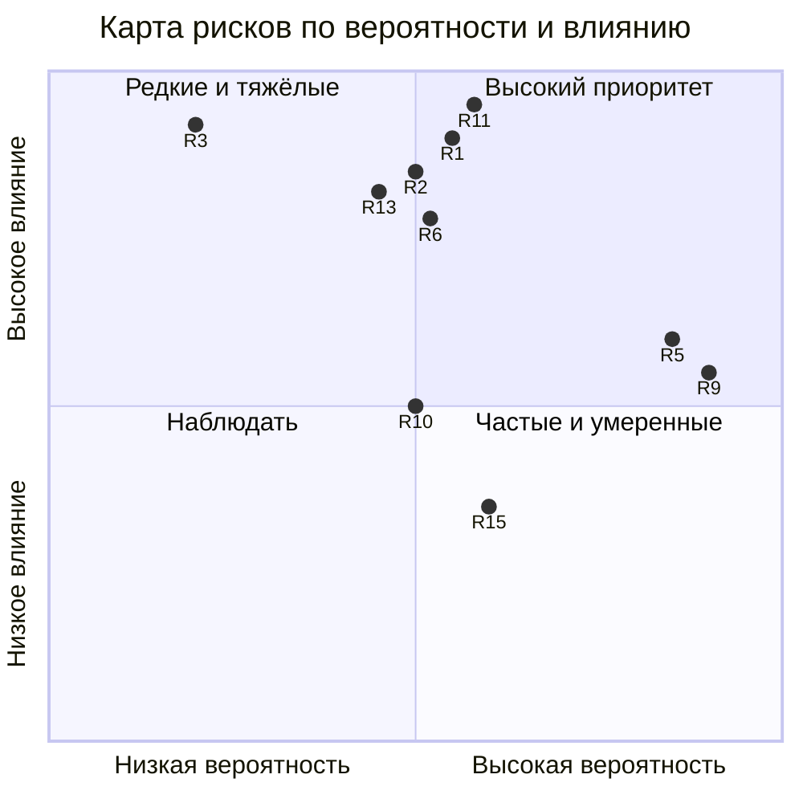

# Глава 6. Риски и меры по их снижению

## 6.1. Методика

Риски оценены экспертно по двум шкалам от 1 до 3: **вероятность** (В) и
**влияние** (Вл). Уровень риска = В × Вл: 1–2 — низкий, 3–4 — средний,
6–9 — высокий. Для каждого риска указаны меры **предупреждения** (снижают
вероятность) и **реагирования** (снижают влияние, если риск реализовался).

## 6.2. Реестр рисков

| № | Риск | В | Вл | Уровень | Предупреждение | Реагирование |
|---|---|---|---|---|---|---|
| Р1 | Ошибка в новой версии останавливает продажи | 2 | 3 | 6 высокий | ≈ 9 800 тестов в CI, независимый аудит веток, репетиция на стенде | Страж 30 мин и автооткат; хранится предыдущий образ |
| Р2 | Двойное начисление или потеря платежа | 2 | 3 | 6 высокий | Идемпотентность по внешнему id на уровне базы, проверка подписи и суммы | Сверка зависших платежей по расписанию; журнал для разбора |
| Р3 | Потеря или повреждение базы данных | 1 | 3 | 3 средний | Ежедневные шифрованные копии в трёх местах | Учения по восстановлению (≈ 20 с); проверенный порядок восстановления |
| Р4 | Потеря ключа шифрования копий | 1 | 3 | 3 средний | Ключ хранится отдельно от копий, есть вторая копия ключа у владельца | Регулярная проверка расшифровки копии |
| Р5 | Сбой сторонней панели управления учётными записями | 3 | 2 | 6 высокий | Лимит памяти службы, мониторинг её перезапусков | Автоматический перезапуск; стратегически — замена собственной панелью (п. 4.6) |
| Р6 | Зависимость от внешних платформ (мессенджер, агрегатор, почта) | 2 | 3 | 6 высокий | Две независимые платёжные схемы; веб-кабинет как второй канал, не зависящий от мессенджера | Перевод клиентов на работающий канал; информирование через страницу статуса |
| Р7 | Компрометация учётной записи администратора | 1 | 3 | 3 средний | Роли, изменения только у сессии владельца, защита входа от подбора кода | Журнал действий для расследования, отзыв сессий, смена секретов |
| Р8 | Утечка секретов | 1 | 3 | 3 средний | Секреты отделены от настроек, у каждой службы — только свои; секретов нет в репозитории | Порядок ротации каждого ключа описан заранее |
| Р9 | Атаки на сервер (подбор паролей, сканирование) | 3 | 2 | 6 высокий | Вход только по ключу, сетевой экран с явным списком правил | Автоматический бан атакующих адресов, жалобы в общую базу злоупотреблений |
| Р10 | Ошибки ИИ-исполнителей (неверное понимание задачи, «уверенная» неправда) | 2 | 2 | 4 средний | Узкие области ответственности, перечень запрещённых без согласия действий, доказательства в отчёте | Независимая проверка координатором и аудитом; откат |
| Р11 | Зависимость от одного человека (владельца) | 2 | 3 | 6 высокий | Автоматизация типового потока; письменные инструкции (runbook) | Сервис продолжает продавать и выдавать доступ без владельца; тревоги копятся до его возвращения |
| Р12 | Миграция схемы базы делает откат невозможным | 1 | 3 | 3 средний | Два шага PREPARE → EXPAND, репетиция на стенде | Ручная копия перед EXPAND с проверкой восстановления |
| Р13 | Сбой при переключении на собственную панель | 2 | 3 | 6 высокий | Теневая сверка, сутки параллельной работы, постепенное переключение | Откат флагом на старую панель, которая сохраняется до конца проекта |
| Р14 | Изменение требований к обработке персональных данных | 2 | 2 | 4 средний | Минимизация данных: хранится только необходимое, журналы — с ограниченным сроком | Пересмотр политики конфиденциальности и сроков хранения |
| Р15 | Усталость от тревог (ложные срабатывания) | 2 | 2 | 4 средний | Пороги и задержки (например, ожидание запуска контейнера до 90 с), объединение повторов | Разбор каждой ложной тревоги и правка правила |

## 6.3. Карта рисков

Точки подписаны номерами рисков из реестра (R1 = Р1 и т. д.). Правый
верхний квадрант — высокий приоритет; левый верхний — редкие, но тяжёлые
риски, для которых главное — резервы и учения; правый нижний — частые
умеренные риски, реакцию на которые выгодно автоматизировать.

## 6.4. Выводы по рискам

Высокие риски сосредоточены в трёх группах:

1. **Изменения** (Р1, Р12, Р13) — снижаются инженерной дисциплиной:
   тесты, стенд, постепенное включение и, главное, заранее подготовленный
   откат. Это та же логика, что лежит в основе практик непрерывной поставки
   [8], [9].
2. **Внешние зависимости** (Р5, Р6) — снижаются дублированием каналов и
   выводом критичных функций из-под контроля поставщика. Проект собственной
   панели — прямое следствие анализа риска Р5.
3. **Человеческий фактор** (Р10, Р11) — снижается тем, что типовой поток
   не требует человека, а нетиповые действия требуют явного согласия
   владельца и оставляют след в журнале.

Остаточный риск, который не устраняется силами малого предприятия, —
зависимость от внешних платформ. Его можно лишь смягчить, держа
альтернативные каналы продаж и связи с клиентом в рабочем состоянии.
